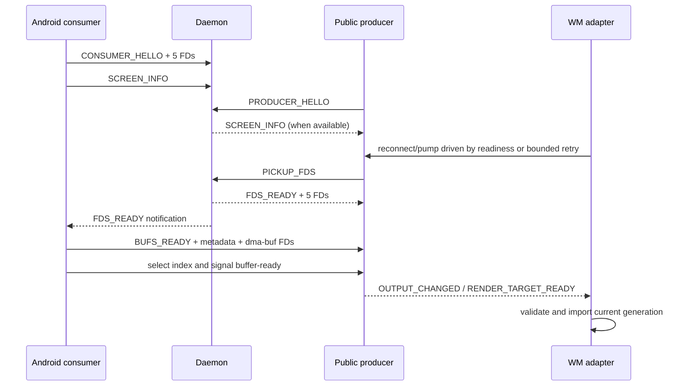
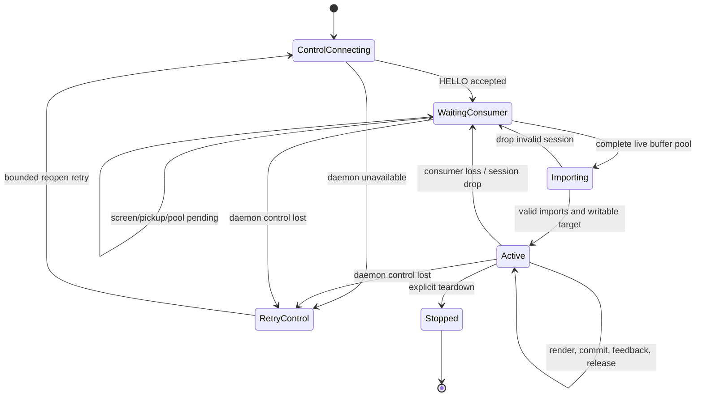
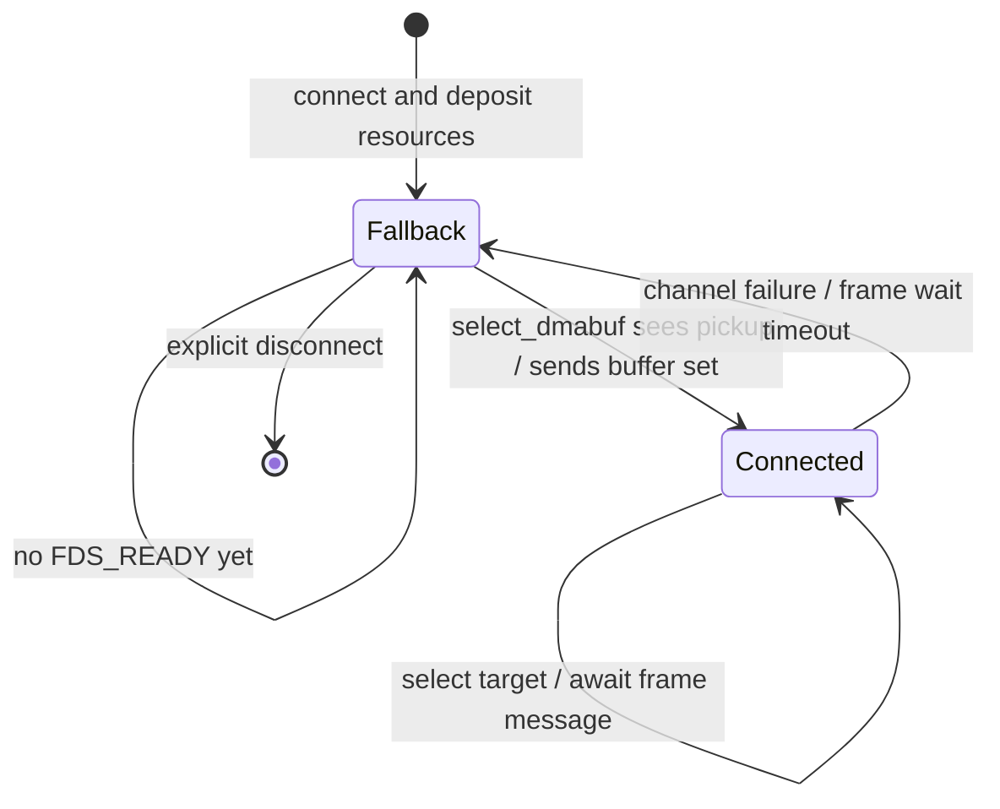
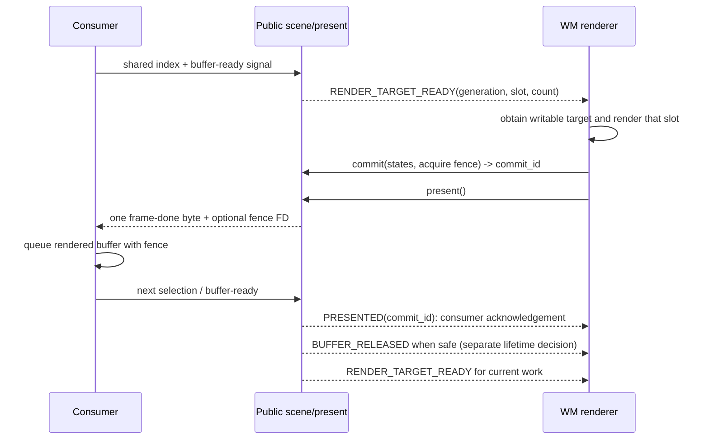

# Anland v5

<p align="left">
  
  
</p>

**Run a Linux Wayland desktop on an Android display using shared GPU buffers.**
The Linux compositor still manages windows, composes the complete desktop and handles its native seat and session. The Android consumer owns the display buffers and presents the rendered output; a small Unix-socket daemon brokers the connection and passes file descriptors.

[中文](README_zh.md) · [User guide](doc/UserManual/anland_guide.md) · [Android settings](doc/UserManual/anland_settings_guide.md) · [V3 archive](doc/History/v3.md)

This README describes the current v5 source tree, including Denial. Directory presence means a port recipe exists, **not** that every distribution, GPU or feature has passed build and graphical validation. Public headers, source locks and executable script behavior take precedence over examples and historical documentation.

## Start here

A working setup needs an Android daemon and consumer, **one** Linux compositor/producer, and a GPU stack that can import the shared buffers. You do not need to build every compositor in this repository.

| Goal | Read next |
|---|---|
| Install and use an Android-hosted desktop | [User guide](doc/UserManual/anland_guide.md), then [Android settings](doc/UserManual/anland_settings_guide.md) |
| Build a particular Linux desktop | Choose a matching [compositor/distribution entry](#section-3), read [build boundaries](#section-6), then [startup and validation](#section-8) |
| Develop or diagnose a backend | Start with the [frame contract](#section-4); use the [API map](#section-13) and [troubleshooting table](#section-15) as references |

## Contents

- Overview and use: [repository](#section-1) · [architecture](#section-2) · [compositor index](#section-3) · [build/package](#section-6) · [startup/validation](#section-8)
- Backend development: [frame contract](#section-4) · [input/media](#section-5) · [porting](#section-7) · [migration/diagnosis](#section-15)
- Detailed reference: [wire protocol](#section-9) · [payloads/resources](#section-10) · [recovery](#section-11) · [frame feedback](#section-12) · [APIs](#section-13) · [audio](#section-14) · [history/license](#section-16)

<a id="section-1"></a>

## 1. Repository map

| Area | Purpose |
|---|---|
| [consumers/anland_v5/](consumers/anland_v5/) | Android v5 consumer and application |
| [daemon/](daemon/), [libdisplay_daemon/](libdisplay_daemon/) | Connection broker and daemon implementation |
| [common/](common/) | Wire structures, framing and descriptor passing |
| [libdisplay_consumer/](libdisplay_consumer/) | Consumer-side C transport library |
| [libdisplay_producer/](libdisplay_producer/) | Single public producer implementation: device, scene, presentation, desktop facade and media helpers |
| [producers/](producers/) | One backend per compositor, with distribution-specific integration and packaging |
| [magisk_module/](magisk_module/) | Android daemon deployment materials |
| [doc/UserManual/](doc/UserManual/) | Installation and application settings guides |
| [.github/workflows/build.yml](.github/workflows/build.yml) | Android plain/Tracy APK and daemon build workflow |

The root CMake build produces the daemon and C libraries; it does **not** build all compositor ports or the Android APK. APK builds use Gradle under `consumers/anland_v5/android_consumer/`.

<a id="section-2"></a>

## 2. Architecture and ownership

```text
Linux compositor: native windows, renderer, frame clock, seat and desktop
  -> thin Anland backend: native image imports, events and frame feedback
  -> anland_de_backend
       -> anland_scene / anland_present
       -> anland_scene_legacy (internal existing full-screen transport adapter)
       -> anland_device / display_producer / common protocol
  -> existing daemon -> Android consumer -> Android presentation
```

- **Producer:** renders the complete desktop into consumer-provided targets. It is not an Android per-window forwarding service.
- **Consumer:** owns shared display resources and presentation. Consumer ACKs are not proof of physical scanout or hardware VSync.
- **Daemon:** brokers control connections and resource FD transfer. Steady-state image handoff does not require a daemon round trip per frame.
- **Public producer:** owns transport encoding, commit transactions, feedback, buffer release, backpressure and session invalidation. Backends translate native compositor objects, not duplicate these mechanisms.

One compositor has one backend. Distribution/version differences belong in patches, dependency locks, package recipes and startup configuration. `anland_scene_legacy` is an internal implementation name, **not** a second selectable WM protocol. Producer-local layers do not imply Android per-window Surfaces. A port must not replace the consumer, introduce another wire protocol or maintain its own transport state machine.

<a id="section-3"></a>

## 3. Compositor and distribution index

Paths below are relative to `producers/<name>/`; directory names are case-sensitive.

| Compositor | Backend | Distribution entries in this tree |
|---|---|---|
| [Gamescope](producers/gamescope/) | `anland_backend/` (C session wrapper, C++/Vulkan) | `SteamOS_v5` |
| [GNOME / Mutter](producers/gnome/) | `anland_backend/mutter/` (GObject/Cogl/Clutter) | `Arch_v5`, `Debian13_v5`, `Ubuntu2604_v5`, `Fedora43_v5`, `Fedora44_v5` |
| [KDE / KWin](producers/kde/) | `anland_backend/` (Qt output/EGL/input) | `Arch_v5`, `Debian13_v5`, `Fedora43_v5`, `Fedora44_v5`, `SteamOS_v5`, `ubuntu2604_v5` |
| [Niri](producers/niri/) | `anland_backend/` (Rust/Smithay, C ABI bridge) | `Arch_v5`, `Ubuntu2604_v5`, `Fedora43_v5`, `Fedora44_v5` |
| [Mango](producers/mango/) | `anland_backend/` (wlroots/SceneFX) | `Arch_v5`, `Debian13_v5`, `Ubuntu2604_v5`, `Fedora43_v5`, `Fedora44_v5` |
| [Hyprland / Aquamarine](producers/hyprland/) | `anland_backend/{aquamarine,hyprland}/` | `Arch_v5`, `Debian13_v5`, `Ubuntu2604_v5`, `Fedora43_v5`, `Fedora44_v5` |
| [Denial](producers/denial/) | `anland_backend/` (Rust backend, C session bridge, Flutter desktop integration) | `Arch_v5`, `Ubuntu2604_v5`, `Fedora43_v5`, `Fedora44_v5` |

[producers/xwayland/SteamOS_v5/](producers/xwayland/SteamOS_v5/) contains an additional Xwayland recipe, not a WM backend. Building Mutter or KWin alone does not deliver the complete GNOME or Plasma session; native shells, portals, agents and session data remain necessary. Niri's X11 integration also requires checking xwayland-satellite and its startup relationship.

<a id="section-4"></a>

## 4. Public API and frame contract

Start with [anland_de_backend.h](libdisplay_producer/anland_de_backend.h), [anland_present.h](libdisplay_producer/anland_present.h), [anland_scene.h](libdisplay_producer/anland_scene.h) and [anland_device.h](libdisplay_producer/anland_device.h).

1. Create one `anland_de_backend` owner and add a layer describing the complete composed output with `anland_de_backend_add_window_desc()`.
2. Connect the native event loop to device readiness and scene events. Drive `pump()` and `dispatch()`; creation or connection alone does not mean a render target is available.
3. Query the live output and `anland_de_backend_get_writable_target()`. `get_target()` only describes a published target; it does not prove that rendering into it is safe.
4. Import targets through the native renderer. Track **session generation and slot**, use the actual buffer count, and validate dimensions, strides, offsets, format and modifier. `anland_device_get_drm_fb()` returns DRM fourcc metadata and a caller-owned duplicate FD; do not treat raw protocol/HAL formats as DRM fourcc.
5. Render into the recorded target, export an acquire fence or explicitly wait for GPU completion, then revalidate generation/slot before committing.
6. Call `anland_de_backend_commit(..., &commit_id)`, record its native-frame association, then `present()`. Continue `pump()`/`dispatch()` to finish or drop that frame and process release.

| Scene event | Meaning for the native compositor |
|---|---|
| `RENDER_TARGET_READY` | Re-query and validate a target; schedule rendering only when writable. Not previous-frame completion. |
| `PRESENTED` | Finish the matching commit's native frame using the available consumer feedback, not invented hardware timing. |
| `BUFFER_RELEASED` | Process the release fence and allow safe reuse. Do not destroy an imported image every frame. |
| `COMMIT_DROPPED` | End the matching frame's wait through its drop/cancel path. |
| `OUTPUT_CHANGED` | Refresh output mode and imports/damage history as needed. |

**Ownership and safety:** acquire fences passed to commit are borrowed; release fences returned by dispatch and duplicated buffer FDs are caller-owned. Device data, buffer-ready and audio FDs are borrowed. Explicitly initialize an absent acquire fence to `-1`, not zero. Failed release synchronization must not permit buffer reuse. Keep frame-path operations serialized in the compositor event loop.

Backpressure retains repaint/damage requests until a writable target appears. On consumer loss use `reconnect()`; on daemon/control loss use `reopen()`; invalid imports or bad session data require `drop_session()` and local cleanup. Generation changes invalidate old targets, callbacks and imports. Watcher identity includes owner and event mask, not just the FD number. Stop media engines using session resources before destroying their owner.

Use full-frame redraw as the initial baseline. Buffer-age/damage optimizations require correct real-slot history across rotation, resize and reconnect.

<a id="section-5"></a>

## 5. Transport, input and media

The wire source of truth is [common/protocol.h](common/protocol.h), with framing/FD helpers in [common/socket_utils.c](common/socket_utils.c). The device's built-in default socket is `/data/local/tmp/display_daemon.sock`; `ANLAND_SOCKET`, explicit endpoint configuration and discovery locations can alter it. Read the selected startup script rather than assuming all ports use the same endpoint.

| Path | Responsibility |
|---|---|
| Control Unix socket | Daemon registration, output information and resource pickup |
| Data channel | Buffer-set transfer, input/output events, variable-length clipboard/text and service resource messages |
| Buffer-ready eventfd + shared index page | Consumer selects the target for producer rendering |
| Fence channel | Render handoff with optional synchronization FD |
| Dedicated audio channel | Desktop playback and microphone capture without placing PCM on the input channel |

Current protocol definitions extend beyond v3: text input, actions, resource FDs, consumer runtime variables, foreground scheduling, and audio format/PCM/shared-memory messages. The audio endpoint uses hello FD slot 4 in the current protocol; the old README's four-FD-only description is historical, not today's integration contract.

- Feed keyboard, pointer and touch through native seat APIs; clear pressed state on disconnect.
- Handle or fully consume variable-length payloads and ancillary FDs, including unsupported services. Apply limits and read deadlines; leaving bytes or descriptors pending breaks framing.
- Clipboard export should use `anland_device_queue_clipboard()`, `pending_output()` and `flush_output()` with writable readiness. Queue acceptance is not delivery. Avoid echo loops and stale asynchronous selection results.
- Prefer native text-input/IME submission. Any fallback must validate complete UTF-8 and target only the focused client, without activating global WM shortcuts.
- Reuse [anland_audio.h](libdisplay_producer/anland_audio.h) and [anland_camera.h](libdisplay_producer/anland_camera.h), but claim a feature only when that WM actually wires it.
- Pointer capture and foreground scheduling use public device controls with reconnect state restoration. Touch gestures require actual touch contacts, not fabricated finger metadata from wheel events.

Historical v1/v2/v3 compatibility claims do not establish v5 interoperability. Build and deploy matching consumer, protocol, producer/bridge and backend inputs; a `5.0.0` pkg-config version alone does not prove a particular API exists.

<a id="section-6"></a>

## 6. Building and packaging

Use the `build.sh` and package recipe in the selected distribution entry. Read its accepted parameters first: there is no universal stage CLI or dependency-install switch. Prefer ordinary-user builds, persistent caches outside the repository, locked source revisions and native packages.

| What you need | Build entry | What it does not produce |
|---|---|---|
| Android application | Gradle in `consumers/anland_v5/android_consumer/`; see the [Android workflow](.github/workflows/build.yml) | A Linux compositor package |
| Daemon and C libraries | Root `CMakeLists.txt`; Android and Linux select different targets/dependencies | The APK or all WM ports |
| A Linux compositor and its integration | The chosen `producers/<wm>/<distribution>/` recipe | Proof that the installed desktop or GPU has been validated |

**Build, installation and graphical startup are separate operations.** Build entries generally gate final installation with `ANLAND_INSTALL=1` (some also support `INSTALL`), but dependency preparation may still use sudo. Review the actual script before running it. Installation can replace distribution WM/Xwayland packages; it is not permission to restart a running desktop or audio service.

Examples, run from the repository root in the matching Linux environment:

```sh
# Arch Linux ARM; KWin recipe pins its supported upstream version.
JOBS=4 ANLAND_INSTALL=0 bash producers/kde/Arch_v5/build.sh --noconfirm

# Debian 13 ARM64; environment variables, not historical stage arguments.
JOBS=4 ANLAND_INSTALL=0 bash producers/hyprland/Debian13_v5/build.sh
JOBS=2 ANLAND_INSTALL=0 bash producers/mango/Debian13_v5/build.sh

# Arch Linux ARM; ordinary user, dependencies may be installed explicitly.
JOBS=2 ANLAND_WITH_DEPS=1 ANLAND_INSTALL=0 \
  bash producers/denial/Arch_v5/build.sh --noconfirm
```

### Ubuntu 26.04 ARM64 entries

Denial, Hyprland, Mango and Niri have `Ubuntu2604_v5/build.sh`. Use `ANLAND_WITH_DEPS=1 JOBS=4 ANLAND_INSTALL=0 bash producers/<wm>/Ubuntu2604_v5/build.sh`; native `.deb` files go to that entry's `artifacts/` (override `ARTIFACTS_DIR`). These entries collect only native installation packages and print package SHA256 hashes in the build log; build manifests, signing keys and checksum files are not added to the delivery. The existing backend/patch source baseline is retained: Hyprland 0.55.2 uses its locked stack instead of Ubuntu's older Hyprland, Mango builds newer graphics dependencies privately, Denial reuses the inline no-GTK Flutter tool adaptation and locked Rust toolchain, and Niri includes pinned xwayland-satellite. Xwayland source locks/build steps and the same non-SteamOS patch stay within each WM recipe. Full cloud builds and graphical validation are still pending.

Package collection follows native build outputs: `makepkg --packagelist` on Arch; the current `.changes` file for `dpkg-buildpackage`; explicit package paths and metadata for direct Debian packaging. Fresh-build checks prevent old cached packages from being reported as new results. Source locks and internal build records stay in the cache, and CI build logs are kept separate from downloadable installation packages.

### Fedora 44 ARM64 entries

Denial, GNOME, Hyprland, KDE, Mango and Niri provide `Fedora44_v5/`, alongside the unchanged Fedora 43 entries. Except for KDE, use `ANLAND_WITH_DEPS=1 JOBS=4 ANLAND_INSTALL=0 bash producers/<wm>/Fedora44_v5/build.sh`; `ANLAND_STAGE=check|prepare|build` selects preflight, source preparation or compilation. For KDE use `JOBS=4 BUILD_XWAYLAND=1 ANLAND_INSTALL=0 bash producers/kde/Fedora44_v5/build.sh`.

Fedora 44 pins native SRPMs and SHA256 for Mutter **50.6 / ABI 18** (GNOME Shell 50), KWin **6.7.5** and Xwayland **24.1.14**. Hyprland retains the locked **0.55.2 / Lua 5.4** stack, private scanner 0.4.6 and protocols 0.7.1, `libuuid-devel`, and the Fedora Lua pkg-config fix. All entries use the existing shared backends and leave Mesa and DNF holds unchanged.

Runtime RPMs go to the entry's `artifacts/` (KDE: `$WORKDIR/{kwin,xwayland}/`). Source verification, package lists and build records remain in `$WORKDIR`, not download artifacts. Cloud collection allows only complete `.rpm`, `.deb`, `.pkg.tar.zst/.xz/.gz` suffixes: no detached signatures, checksum sidecars, keys, lockfiles, manifests, logs or hidden build records. Release archives contain native packages only; internal verification remains enabled. Package-only collection covers build Artifacts and package archives. Separately generated rolling-release installer scripts, manifests and release-level `SHA256SUMS` remain outside these package deliverables because existing installers depend on them. Full cloud builds and graphical validation of these new entries have not been performed.

### Public-library linkage

Use one public implementation per product: dynamic `display-producer` through pkg-config, canonical public sources built into the compositor, or a narrow C bridge used from Rust. `producer.cmake` centralizes sources and dependencies; `presentation.cmake` supplies presentation objects; `display-producer.pc.in` supplies discovery metadata. Do not both embed and dynamically link duplicate implementations. Generate self-contained overlays from the canonical tree, resolving repository symlinks for packaging; do not maintain copied transport forks. Verify the actual APIs by compile/link tests, not version strings alone.

### Current build-chain notes

- **Hyprland / Debian 13:** lockfile covers the dependency stack and plugin ABI; public producer is built into Aquamarine. Build artifacts go to `producers/hyprland/Debian13_v5/artifacts/`. Default `JOBS=4`; `nocheck nodwz` means package success is **not** proof of tests passing.
- **Mango / Debian 13:** private-prefix shared producer, wlroots and SceneFX; artifacts go to `producers/mango/Debian13_v5/artifacts/`. Default `JOBS=2`.
- **Denial / Arch:** [dependencies.lock](producers/denial/Arch_v5/dependencies.lock) pins Denial `0.5.0-anland5` and Flutter `3.47.5` revisions; Cargo/pub locks cover transitive dependencies. Cache defaults to `$XDG_CACHE_HOME/denial-anland` or `$HOME/.cache/denial-anland`; output defaults to `$WORKDIR/packages`, overridable with `ARTIFACTS_DIR`. `ANLAND_ENGINE_MODE=auto|build|prepared`, `ANLAND_OFFLINE=1` and `ANLAND_WITH_DE=0` select engine/cache/desktop behavior. Outputs are unsigned native packages for the engine, `denial`, optional `denial-desktop` and patched Xwayland. The script records package SHA256 hashes in the build log; it does not generate release signatures, `packages.list`, `manifest.env` or `SHA256SUMS` in the artifact directory. Keep the log with the packages; a hash is not a release signature.

### Xwayland

Denial's Arch entry uses the same Xwayland `24.1.13` recipe/patch as KDE Arch, with `XWAYLAND_TARBALL` for a local archive and `XWAYLAND_PATCH` for an override. The package is included in Denial's artifact checks, logged SHA256 hashes and optional installation; no signature is generated. Debian Hyprland/Mango use their own locked Xwayland source recipes; do not apply one distribution's patch to arbitrary versions.

The kgsl/Turnip compatibility patch permits implicit-modifier dma-bufs, avoids waiting for v4 feedback on a v3-only compositor, and allows a render-device fallback (`XWAYLAND_GBM_DEVICE`). The `1274 -> LINEAR` workaround is specific to a known freedreno/kgsl path, not permission to guess any unknown modifier. New build designs should isolate Xwayland from WM-private library/toolchain variables. Installing a new package does not restart a live Xwayland process.

<a id="section-7"></a>

## 7. Porting a compositor

Choose the closest native integration: Mutter for C/GObject, KWin for C++/Qt, Gamescope for Vulkan, Niri/Denial for Rust plus C bridge, Mango for wlroots, or Hyprland for Aquamarine. Read the actual current code before copying a historical pattern.

1. Record upstream revision, renderer/import support, event loop, frame lifecycle, seat/text/clipboard interfaces, GPU/fence capabilities, target architecture and full-session dependencies.
2. Keep the backend separate; version patches register it and expose the minimum native hooks. Public mechanisms stay in `libdisplay_producer/`.
3. Establish the writable-target -> render -> commit/present -> feedback/release loop before adding desktop services.
4. Lock source archives/commits, submodules, dependency revisions and compatible patches. Verify expected hashes before extraction where possible; never ignore patch failures.
5. Build dependencies in dependency order, then the public library/bridge as required, the WM and native packages. A distribution with no WM package still supplies tools and libraries; create a PKGBUILD, Debian package or RPM spec rather than falling back to global `sudo make install`.
6. Separate prepare, compile, packaging, validation, optional install and authorized graphical tests. Keep one backend and one public implementation; do not change the Android consumer to make a WM port work.

<a id="section-8"></a>

## 8. Startup and validation

Use the chosen `startup.sh` or installed session entry only after reviewing its environment and configuration. Device-specific GPU variables belong in that entry, not global defaults. Do not overwrite user configuration, seize another producer session, or automatically terminate/restart the WM, PipeWire, daemon or consumer. A `--check` preflight, where provided, is not a consumer handshake or graphical smoke test.

A complete validation record distinguishes:

- **Static review:** source, API contracts, patches and script inspection. This does not establish compilation, link compatibility or runtime correctness.
- **Contract tests:** first target versus presentation; accepted/ACK/released states; backpressure; failed commits and fences; old generations; FD ownership; resize/reconnect and watcher reuse; bounded clipboard/text/resource handling.
- **Build/package checks:** real compiler/linker exit status, explicit log conclusion, architecture, contents, dependencies, symbols and RPATH. Compare hashes with previous artifacts to catch stale incremental objects; timestamps alone are insufficient.
- **Authorized graphical tests:** first frame and sustained redraw, windows/cursor/effects, input and declared media, consumer/daemon recovery, rotation/resize, Wayland and X11 clients.

The Android workflow contains native input-grab and JVM unit-test steps; that is not coverage for all producer ports.

<a id="section-9"></a>

## 9. Wire protocol reference

This section documents the checked-in C transport, not a new portable network protocol. Its packed structures are exchanged on local Unix sockets with `SCM_RIGHTS`. There is no version-negotiation field in `ctrl_msg`/`data_msg`, and no endian conversion in their declarations. Do not use structure sizes or an unchanged message number to infer cross-version compatibility.

### 9.1 Headers and buffer metadata

```c
/* common/protocol.h: both headers are 8 bytes, payload excluded. */
struct ctrl_msg {
    uint32_t type;
    uint32_t size;
    uint8_t payload[];
} __attribute__((packed));
struct data_msg {
    uint32_t type;
    uint32_t size;
    uint8_t payload[];
} __attribute__((packed));

struct screen_info {
    uint32_t width, height, format, refresh;
} __attribute__((packed));

struct buf_info {
    uint32_t stride;    /* bytes */
    uint32_t width;
    uint32_t height;
    uint32_t format;    /* transport/HAL convention, NOT automatically DRM fourcc */
    uint64_t modifier;
    uint32_t offset;
} __attribute__((packed));
```

`screen_info` is 16 bytes and `buf_info` is 28 bytes in this packed definition. The public output view names the refresh field `refresh_mhz`; `60000` represents 60 Hz. `MAX_BUFS` is 8, an upper bound rather than a fixed swapchain length. A `BUFS_READY` payload contains `N` metadata records and exactly `N` dma-buf FDs. The producer validates that the byte count is nonzero, divisible by `sizeof(buf_info)`, within the maximum, and consistent with the received descriptor count.

### 9.2 Control messages

`C` = consumer, `P` = producer, `D` = daemon.

| Constant | Value | Direction | Body / descriptors | Current purpose |
|---|---:|---|---|---|
| `CTRL_MSG_CONSUMER_HELLO` | 1 | C -> D | zero payload, five deposited FDs | Register/redeposit consumer resources |
| `CTRL_MSG_PRODUCER_HELLO` | 2 | P -> D | zero payload | Register producer |
| `CTRL_MSG_SCREEN_INFO` | 7 | C -> D -> P | `screen_info` | Store geometry/format/refresh; deliver to a waiting producer |
| `CTRL_MSG_REJECT` | 8 | defined | — | Defined constant; not the current daemon's geometry-change policy |
| `CTRL_MSG_PICKUP_FDS` | 9 | P -> D | zero payload | Request the deposited session resources |
| `CTRL_MSG_FDS_READY` | 10 | D -> P, D -> C | five FDs to P; notification to C | Finish resource handoff |

The daemon currently keeps at most one consumer and one producer. A new client claiming a role replaces the previous client; startup/session locks should prevent unintentional takeover. On consumer loss it clears stale deposits. Unlike the archived v3 description, `libdisplay_daemon/display_daemon.c` **accepts updated screen information**, stores it and forwards it to a waiting producer; it does not reject a different geometry using a permanent first-mode lock. This is not a guarantee of live native mode changes without session/import updates.

### 9.3 Deposited descriptor layout

`libdisplay_consumer/display_consumer.c::send_hello_fds()` deposits five descriptors, and the current producer pickup requires **exactly five**:

| Slot | Resource | Direction / semantics |
|---:|---|---|
| 0 | `buf_ready_efd` | C -> P pacing/target selection eventfd |
| 1 | producer end of fence socketpair | P -> C frame-done message plus optional acquire fence FD |
| 2 | producer end of data socketpair | Bidirectional event/resource transport; initial buffer-set transfer |
| 3 | `shm_fd` | Shared `uint32_t` selected-buffer index; P maps it read-only |
| 4 | producer end of audio socketpair | Full-duplex playback and microphone stream |

The consumer retains its own socketpair ends and closes the deposited local copies after sending. `SCM_RIGHTS` produces descriptors in the receiving process; it does not transmit numeric FD identity. The daemon closes its copies after delivery. Device accessors expose borrowed session descriptors; native renderer imports use separately owned duplicates. A legacy four-FD consumer is **not** accepted by the current producer just because the first four slots match.

### 9.4 Data message types

| Constant | Value | Direction | Payload |
|---|---:|---|---|
| `DATA_MSG_BUF_READY` | 100 | reserved in the current frame path | Selection uses eventfd + shared page instead |
| `DATA_MSG_REFRESH_DONE` | 101 | reserved in the current frame path | Completion handoff uses the fence socketpair instead |
| `DATA_MSG_INPUT_EVENT` | 102 | C -> P | Packed `InputEvent`, possibly followed by raw bytes |
| `DATA_MSG_OUTPUT_EVENT` | 103 | P -> C | Packed `OutputEvent`, possibly followed by raw bytes |
| `DATA_MSG_INPUT_EXTEND_FDS` | 104 | C -> P | Follow-up resource descriptor message using `SCM_RIGHTS` |
| `DATA_MSG_BUFS_READY` | 200 | C -> P | `N * buf_info` plus `N` dma-buf FDs |

The packed input/output event records currently each occupy 20 bytes: a 4-byte type and a 16-byte union. The unions include float coordinates and native `pid_t` in the declared output layout; treat them as the current local ABI, not an architecture-independent serialization promise.

### 9.5 Input events

| Type constant suffix (`INPUT_TYPE_`) | Value | Fields / following data |
|---|---:|---|
| `TOUCH` | 1 | `action, x, y, pointer_id` |
| `KEY` | 2 | `action, keycode` |
| `POINTER_MOTION` | 3 | `x, y, dx, dy` |
| `POINTER_BUTTON` | 4 | `button, pressed` |
| `POINTER_AXIS` | 5 | `axis, value, discrete` |
| `TOUCH_FRAME` | 6 | Touch batch boundary |
| `DISPLAY_REFRESH` | 7 | `refresh_mhz` |
| `CLIPBOARD` | 8 | `clipboard.size`, then that many bytes |
| `TEXT_INPUT` | 9 | `text_input.size`, then that many UTF-8 bytes |
| `ACTION` | 10 | `input_action.action, value` |
| `RESOURCE` | 11 | `resource.type, fdnum`, then an extended-FD message |
| `RESOURCE_INVALID` | 12 | Same resource fields; report invalid/unusable service resources |

Touch/key action constants are `DOWN=0`, `UP=1`, `MOVE=2`; conversion to native keycodes and coordinate spaces belongs in the WM adapter. Resource handling must follow the declared descriptor count, not blindly assume no FDs on an error notification. Unsupported events with a known extension still need that extension consumed and owned FDs closed.

### 9.6 Output events

| Type constant (`OUTPUT_TYPE_`) | Value | Fields / effect |
|---|---:|---|
| `CLIPBOARD` | 1 | `clipboard.size`, then raw bytes |
| `RESOURCES_REQUEST` | 2 | service `type` and up to three `uint32_t args` |
| `SET_CONSUMER_VAR` | 3 | `var, value`; transient runtime request |
| `SCHEDULING` | 4 | producer-namespace `pid` and flags |

`SERVICE_TYPE_CAMERA=1`. `CONSUMER_VAR_CAPTURE_MOUSE=1` requests pointer capture; value zero releases the request. Scheduling flags are `SETTREE=0x01` and `ON=0x02`: report the previous focused subtree off before the new one on, with the consumer/root helper resolving the producer PID namespace. These controls do not grant a WM permission to manipulate Android processes directly. Consumer fallback resets transient variables; resend current state after reconnect.

<a id="section-10"></a>

## 10. Variable payloads, queues and service resources

### 10.1 Clipboard/text framing

```text
fixed event:
  [ data header: type, size=20 ][ event: type + union ]

clipboard/text event:
  [ data header: type, size=20 ][ event: type + *.size=L ][ L raw bytes ]

service response:
  [ DATA_MSG_INPUT_EVENT ][ resource: type, fdnum ]
  [ DATA_MSG_INPUT_EXTEND_FDS + ancillary SCM_RIGHTS descriptors ]
```

For event messages, `data_msg.size` describes the **event struct only**, not the trailing clipboard/text length. For `BUFS_READY` it describes the metadata array. Do not generalize either rule to all messages. `clipboard.size`/`text_input.size` must match the actual trailing bytes; never send a variable event through the fixed-only sender.

A Unix stream may split a header, payload or ancillary data across reads. One `recv()` is not one message. The current producer input parser retains partial data/FDs, supports nonblocking `timeout_ms=0`, and expires incomplete input frames after 5 seconds. Its caller must serialize the context, retry the **same pending operation and size**, and not poll the next event header while its extension remains incomplete. This is the producer implementation's contract; do not assume the consumer or every helper has identical timeout behavior.

### 10.2 Bounded clipboard export

The device facade accepts payloads up to **1 MiB** (`ANLAND_DEVICE_MAX_PAYLOAD_SIZE`); the asynchronous output queue is bounded to **2 MiB** in total. Check announced input lengths **before allocating memory or narrowing integer types**, not only when reading the payload. An oversized message must end the session rather than leave its body to be parsed as the next event. These are implementation limits, not negotiated wire features.

```c
/* Illustrative event-loop pattern; not a standalone compositor. */
int rc = anland_device_queue_clipboard(dev, text, size);
if (rc < 0) {
    /* ENOBUFS: leave session intact; retry the latest selection later.
       Other errors: follow the adapter's session/error policy. */
}
/* On writable readiness, and after a budget-limited flush: */
rc = anland_device_flush_output(dev); /* 0 drained, 1 pending, -1 lost */
/* Keep POLLOUT installed iff pending_output(dev) remains nonzero.
   Never write independently to anland_device_data_fd(dev). */
```

All producer writes share queue order, including synchronous APIs. `ENOBUFS` enqueue failure does not change the queue or detach the session. The synchronous `push_output_event*()` path instead has a 10 ms complete-write deadline; backpressure/partial failure detaches the session to preserve framing. That is bounded synchronous I/O, not the asynchronous queue. Selection epochs and strong owners must prevent a delayed offer from overwriting a newer clipboard.

### 10.3 Camera resource lifecycle

```text
WM -> request_resources(CAMERA, args)
consumer -> allocate service -> RESOURCE(type, fdnum)
consumer -> INPUT_EXTEND_FDS(ctrl_fd, stream_fd[...])
WM -> validate counts/layout -> anland_camera_set_resources(...)
Linux app opens virtual camera -> recording starts
app stops / session lost -> stop recording and release resources
```

The consumer library registers `service_info` allocation/free callbacks through `allocate_services()` and handles `OUTPUT_TYPE_RESOURCES_REQUEST` through `handle_resource_request()`. `service_info.userdata` identifies the owning connection rather than requiring global state.

`anland_camera_start()` starts the engine; `set_resources()` **takes ownership** of the control and stream FDs. The control socket is first, followed by one stream socket per camera. `clear()` closes session resources but **keeps virtual nodes alive**, emitting blank frames until fresh resources arrive. A stream HUP/EOF or fatal read error detaches that stream's watcher, FD and mapping and invalidates its old frame; it does not keep replaying the last image. A replacement resource set reconciles the camera count, and `stop()` destroys the nodes and engine. Recording is demand-driven and available only where the WM actually wires the bridge.

<a id="section-11"></a>

## 11. Handshake and recovery state machines

### 11.1 Staged producer connection



Registration order is not fixed; the diagram shows one ordering only. Strict `connect_to_deamon()` waits for screen information without a consumer-arrival deadline. `connect_to_deamon_deferred()`/`defer_connector=true` allow absent-connector startup without inventing a fake mode. Native callbacks should use the deferred/event-driven path when waiting would stall the WM.

`try_exit_fallback()` is now a **nonblocking staged handshake**, not the old repeated blocking 100 ms pickup/read sequence. Partial screen, pickup and buffer records survive retries. The public header specifies a **3-second total deadline for pickup through metadata**, not a separate deadline per read and not a blanket three-second deadline for consumer arrival. `EAGAIN` means pending; EOF/protocol/deadline failure releases partial resources. An ambiguous control reply also closes the daemon connection. Successful pool pickup still does not prove a writable selected target.

### 11.2 Producer lifecycle



`anland_device_connect_result()` distinguishes `READY`, `NO_CONSUMER`, and `DAEMON_LOST`; polling consumer pickup forever cannot recover a dead daemon connection. `reopen()` preserves public device/scene ownership while replacing the control connection; `reconnect()` picks up a consumer on the existing control connection. Layer identity survives scene invalidation; target/import generation does not.

### 11.3 Consumer lifecycle



The consumer lazily tries to leave fallback from `select_dmabuf()`. While connected, `push_dmabufs()` changes the stored pool and triggers fallback/redeposit rather than silently replacing a live producer's imports. Fallback rebuilds eventfd, index page and socketpairs and frees service resources; callbacks let the application stop/restart its associated workers.

`refresh_done()` waits up to **5 seconds** for a fence-channel frame message. A received fence FD is owned by its caller and may be handed to Android's queue operation under that API's ownership rules. `-1` can mean a valid handoff with no fence, no pending frame, or an error/fallback; it is **not** a universal Boolean success flag. A daemon restart additionally requires the application's control reconnection; recreating only the consumer's local socketpairs does not revive a dead control FD.

<a id="section-12"></a>

## 12. Per-frame transport versus scene feedback



The last events describe distinct facts, not a guaranteed universal event order. Release may be delayed by retention or synchronization; the next target cannot be overwritten merely because a previous commit was acknowledged. A static desktop must still service a valid consumer target request, even without new client damage.

### 12.1 Layer state construction

```c
/* Schematic: all rendering/import/error paths remain native WM work. */
anland_de_target_t target;
if (anland_de_backend_get_writable_target(backend, &target) != 0)
    return; /* preserve repaint until readiness */

/* Render into the import for (target.generation, target.index).
   Produce acquire_fd, or explicitly wait until GPU work is complete. */
anland_layer_state_t state = {
    .layer_id = desktop_layer,
    .buffer_id = (uint64_t)target.index + 1, /* current full-screen adapter convention */
    .destination = {0, 0, target.width, target.height},
    .opacity = 1.0f,
    .visible = true,
    .acquire_fence_fd = acquire_fd, /* -1 ONLY if already ready */
};
/* Revalidate target generation/index after rendering, before this call. */
uint64_t commit_id;
if (anland_de_backend_commit(backend, &state, 1, &commit_id) == 0) {
    /* Record commit_id -> native frame FIRST, even if present later fails. */
    int result = anland_de_backend_present(backend);
    /* Handle result; always continue draining drop/release feedback. */
}
/* Scene commit borrows acquire_fd. Close caller's owned fd when appropriate. */
```

`source.width=0` selects the whole source. A visible buffered layer requires nonzero destination dimensions. Layer IDs are opaque/nonzero; `buffer_id=0` means no buffer. `slot+1` is the current full-screen mapping, not a future universal buffer ABI. `damage=NULL, damage_count=0` means the whole source rectangle. This snippet deliberately omits native rendering and FD cleanup implementation; it is not a copy-paste replacement for a backend.

### 12.2 Three different fence contracts

| API boundary | Ownership |
|---|---|
| Scene/DE commit `acquire_fence_fd` | Borrowed during the call; public backend duplicates if retained |
| `anland_device_set_render_fence()` / raw `set_render_fence()` | Takes ownership of the supplied FD |
| `anland_scene_dispatch()` release event / consumer `refresh_done()` output | Receiver owns the returned FD |

Do not mix raw split-frame `set_render_fence()+trigger_refresh()` and device `pageflip()` for one frame. New WM frame paths should use the DE facade, not bypass its bookkeeping through these low-level helpers. Retire resources before removing their synchronization state; a release wait/import failure is a reason to quarantine/stop output, not to close the FD and assume completion.

<a id="section-13"></a>

## 13. API map and return contracts

| API family | Main operations | Important return/lifetime rule |
|---|---|---|
| Desktop facade | `create/destroy`, `add_window_desc/update_window/remove_window`, `commit/present/pump/dispatch` | Owner for normal WM integration; accessors return borrowed objects |
| Target/output | `get_target/get_writable_target/get_output`, `buffer_fd` | Target queries return 0 or -1; duplicated buffer FD is owned |
| Presentation | `connected/target_available/renderable`, `reconnect/reopen/drop_session` | Connected is not synonymous with renderable |
| Scene layers | `layer_create/update/destroy/count` | Stable IDs within scene lifetime; destroyed-layer commits are dropped |
| Scene transaction | `commit_submit`, `commit_is_pending`, `invalidate/generation` | Accepted != presented != released; query is not a cross-thread reservation |
| Scene feedback | `event_fd`, `dispatch`, `pending_events` | `dispatch` drains eventfd; caller must not drain it independently |
| Device session | `open/open_deferred`, `connect_result`, `is_daemon_alive`, `reopen` | Distinguish no consumer from dead daemon |
| Native image view | `fb_count`, `get_fb/get_drm_fb`, `current_fb_raw` | Format domains differ; caller closes duplicated FD |
| Input | `poll_input/read_input/read_fds` | 1 complete, 0 pending/none, -1 lost; read extensions before next header |
| Async output | `queue_clipboard`, `flush_output`, `pending_output` | Enqueue 0 accepted; flush 0 drained / 1 pending / -1 lost |
| Media | audio `start/set_fd/stop`; camera `start/set_resources/clear/stop` | Audio duplicates a borrowed socket; camera adopts resource FDs |
| Consumer | `connect_to_deamon`, `set_screen_info`, `push_dmabufs`, `select_dmabuf`, `refresh_done` | Separate registration, pool publication, selection and frame wait |

Scene backend reporting functions (`backend_handed_off/presented/dropped/release_buffer/...`) implement the public presentation backend's side of the contract, not a second transport a WM should recreate. `anland_scene_backend_release_buffer()` takes ownership of the release FD on **all** paths; this differs from a commit's borrowed fence.

Current limits include 32 scene layers, 8 damage rectangles per layer snapshot, 64 named bytes, a 64-entry scene event queue and a separately bounded 1024-release notification capacity. See header constants and actual overflow handling when designing integrations; these are not new Android multi-window capabilities.

<a id="section-14"></a>

## 14. Audio engine details

Audio uses its own full-duplex stream, with an 8-byte packed `audio_msg {type,size}` header. Each direction describes its role and format before PCM. The current `audio_format` contains five `uint32_t` fields (20 bytes): `rate`, `channels`, `format`, `role`, `quantum`.

| Constant | Value | Meaning |
|---|---:|---|
| `AUDIO_MSG_FORMAT` | 1 | Format/role/quantum announcement |
| `AUDIO_MSG_PCM` | 2 | PCM payload |
| `AUDIO_MSG_SHM` | 3 | Shared-memory ring transport request |
| `AUDIO_MSG_SHM_FD` | 4 | Shared-memory descriptor transfer |
| `AUDIO_FORMAT_S16LE` | 0 | Interleaved signed 16-bit little-endian PCM |
| `AUDIO_ROLE_PLAYBACK` | 0 | Linux desktop -> Android speaker |
| `AUDIO_ROLE_CAPTURE` | 1 | Android microphone -> Linux virtual source |

Stereo frame order is left then right (FL/FR). PCM byte accounting is `frames * channels * 2` for S16LE; all counts must be validated before multiplication/allocation. `quantum` is measured in audio frames, zero means engine default. Consumer hardware-chosen rate/channels drive negotiation; do not assume every device uses 48 kHz stereo or that declaring an extension means every path uses it.

The producer audio engine keeps PipeWire streams alive across consumer loss: detached playback is discarded and the microphone source supplies silence. `anland_audio_set_fd(-1)` detaches, while `stop()` destroys the engine. Rebinding resets microphone buffering and reannounces playback format, so do not invoke `set_fd()` every rendered frame. Compare both FD identity and session generation: numeric reuse can hide a new connection.

<a id="section-15"></a>

## 15. Migration, reproducibility and diagnosis

### 15.1 Migrating from the historical transport integration

| Historical assumption | Current action |
|---|---|
| Four deposited FDs and unchanged old daemon | Use matching current daemon/consumer/producer; audio makes pickup five-FD |
| First buffer-ready means a frame was displayed | Treat it as target-ready; wait for feedback tied to an actual commit |
| `trigger_refresh()` success is native presentation | Use facade commit/present and matching scene events |
| A slot index permanently identifies a buffer | Include generation; reimport on new pool/session |
| Every unknown event is fixed-size | Drain known payload/FD extensions or fail closed; preserve stream framing |
| Any no-fence result means GPU work is done | Export a real fence or explicitly complete GPU work |
| A public API version string proves capabilities | Compile/link against the actual called functions |
| Copied producer snippets may be maintained in each port | Generate overlays from the canonical public implementation |

The historical raw symbol spelling `connect_to_deamon` remains as declared; do not silently rename it in examples. Old migration instructions to copy only `display_producer.c`/`protocol.h` do not include the current scene/present/device/media implementation. Rebuild native bridges and WM packages together when their dependencies or ABI change.

### 15.2 Reproducible input and output record

Record WM/public-source revisions, lockfile and patch hashes, target architecture, compiler/toolchain, build flags, enabled features, dependency sources and artifact hashes. Dependency downloads should finish before offline configure/compile; use Cargo locks and pinned wraps/submodules. For Quilt, create/register the patch **before** editing its files, then refresh. A source-identity stamp does not detect every manual edit or invalidate every stale object.

Validate packages through their native metadata and extraction, not just filenames: `bsdtar`/`pacman` for Arch, `dpkg-deb` for Debian, RPM tools for RPM. Dynamic integration should show correct ELF dependencies/RPATH and exported/imported APIs; static integration needs actual calls/link-map evidence and need not show `DT_NEEDED: libdisplay_producer.so`. Ensure generated overlays resolve symlinks and omit cache/build artifacts and personal paths.

### 15.3 Troubleshooting by boundary

| Symptom | First checks | Avoid |
|---|---|---|
| No daemon connection | Actual selected endpoint, mount/permissions, daemon log/control health | Guessing from a different port's default socket |
| Daemon works but no output | Consumer arrival, screen-info stage, five-FD pickup, metadata count and target readiness | Inventing a mode or busy-looping pickup |
| First frame appears, then freezes | Commit ID completion, pending/release state, event-loop pump/dispatch, target response | Reporting every eventfd signal as presentation |
| Low GPU utilization in vkmark or another client | Actual FPS, output refresh, client present mode, frame pacing, consumer ACK and buffer-release waits | Removing fences/backpressure or assuming low utilization alone proves slow rendering |
| Black/corrupt image | Format domain, modifier/stride/offset, import support and acquire fence | Guessing unknown fourcc/modifier or substituting CPU readback silently |
| Reconnect fails | Control alive vs consumer absent, watcher refresh, new generation/import set | Reusing old same-number FDs or slots |
| Stuck input or wrong refresh after reconnect | Release/cancel of old pressed states; mode, IPC and frame-clock refresh updates | Only clearing local bookkeeping or updating geometry alone |
| Clipboard/input stream stalls | Pending extension, short reads/writes, queue limits and payload deadlines | Polling a new header before extension completion |
| Old clipboard content returns | Selection/session generation of asynchronous results; complete EOF within size/time bounds | Forwarding a delayed or truncated result as the current selection |
| No sound | PipeWire session, installed bridge API calls, bound audio FD, node routing and negotiation | Only adding `PULSE_SERVER` when the bridge is not wired |
| Camera freezes or uses CPU after stream loss | Stream HUP/EOF cleanup, I/O watcher removal and old-frame invalidation | Leaving a disconnected FD registered or treating the last frame as live |
| X11 fails, Wayland works | Actually installed patched Xwayland, render-device path, satellite where needed | Assuming building a new package restarted the live server |
| Package timestamp is new but behavior unchanged | Hash versus prior package, affected objects actually recompiled, installed file identity | Treating timestamps or wrapper rc=0 as build proof |

Use non-destructive logs and preflight before authorized runtime testing. Preserve known successful deployment configuration and evidence; a deliberately broken test configuration is not proof that the original setup never worked.

<a id="section-16"></a>

## 16. History and license

- [V1](doc/History/v1.md)
- [V2](doc/History/v2.md)
- [V3 — original English and Chinese READMEs](doc/History/v3.md)

The root [LICENSE](LICENSE) contains **GNU GPL v3**. Consult component and upstream notices for their applicable terms, including compositor, Flutter and bundled dependencies; this README does not grant a blanket MIT license or relicense third-party code. Historical README statements are retained for archival purposes, not current licensing authority.
