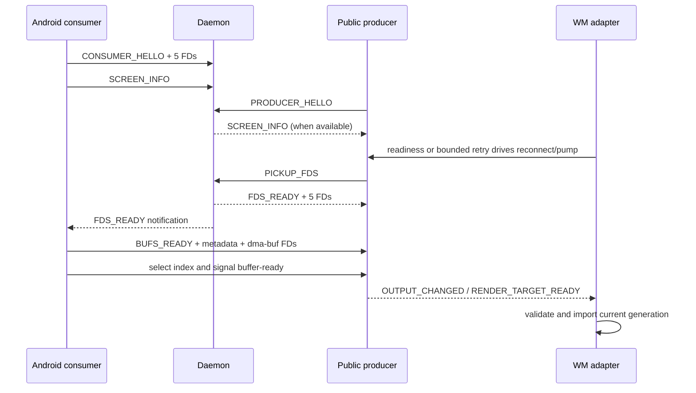
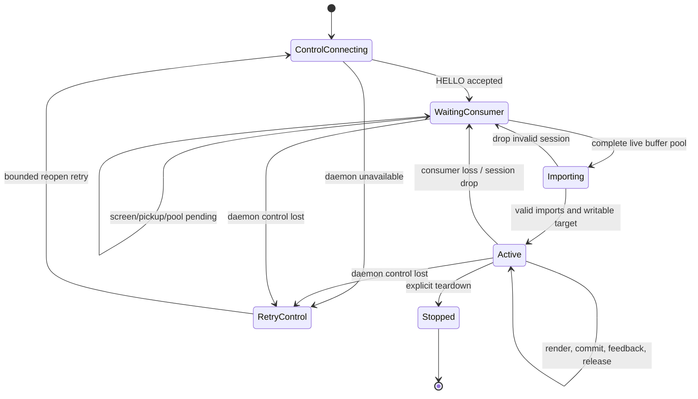
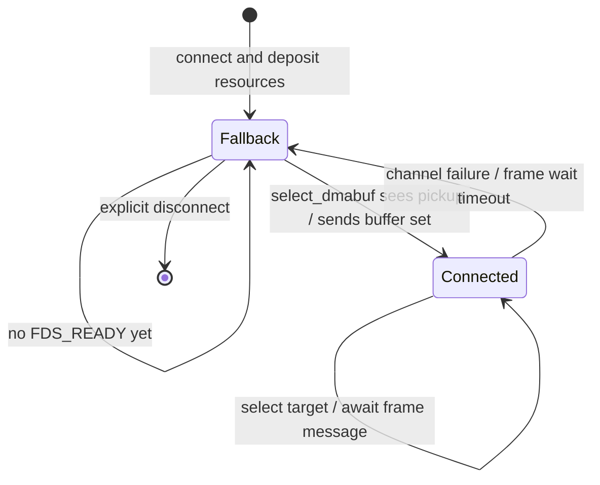
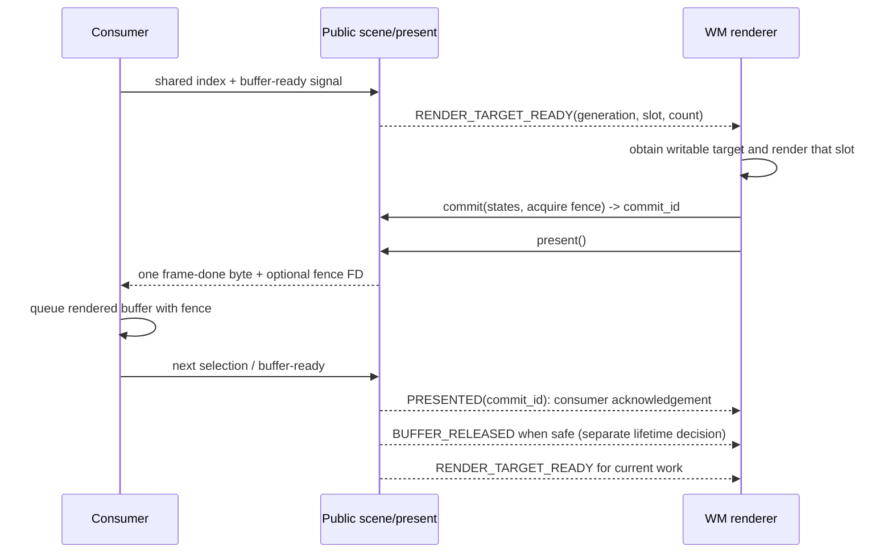

# Anland v5

<p align="left">
  
  
</p>

**通过共享 GPU 缓冲区，将 Linux Wayland 桌面呈现在 Android 屏幕上。**
Linux 合成器仍负责窗口管理、完整桌面合成、原生 seat 和会话；Android consumer 拥有显示缓冲区并呈现渲染结果，轻量 Unix socket daemon 负责连接对接与文件描述符传递。

[English](README.md) · [使用指南](doc/UserManual/anland_guide_zh.md) · [Android 设置说明](doc/UserManual/anland_settings_guide_zh.md) · [V3 历史文档](doc/History/v3.md)

本文描述当前 v5 源码树，包含 Denial。目录存在只表示适配配方已纳入仓库，**不表示所有发行版、GPU 和功能均已通过编译或图形验证**。公共头文件、源码锁定清单和脚本实际行为优先于示例及历史文档。

## 从这里开始

一套可用环境需要 Android daemon 与 consumer、**一个** Linux 合成器／producer，以及能够导入共享缓冲区的 GPU 驱动栈。无需构建仓库中的所有合成器。

| 目标 | 下一步 |
|---|---|
| 安装并使用 Android 上的 Linux 桌面 | 阅读[使用指南](doc/UserManual/anland_guide_zh.md)和 [Android 设置说明](doc/UserManual/anland_settings_guide_zh.md) |
| 构建指定 Linux 桌面 | 选择匹配的[合成器／发行版入口](#section-3)，核对[构建边界](#section-6)，再阅读[启动与验证](#section-8) |
| 开发或诊断后端 | 先读[帧生命周期契约](#section-4)，按需查阅 [API 索引](#section-13)和[排障表](#section-15) |

## 目录

- 概览与使用：[仓库索引](#section-1) · [架构](#section-2) · [合成器入口](#section-3) · [构建打包](#section-6) · [启动验证](#section-8)
- 后端开发：[帧契约](#section-4) · [输入与媒体](#section-5) · [适配流程](#section-7) · [迁移与诊断](#section-15)
- 详细参考：[线上协议](#section-9) · [负载与资源](#section-10) · [恢复状态机](#section-11) · [帧反馈](#section-12) · [API](#section-13) · [音频](#section-14) · [历史与许可](#section-16)

<a id="section-1"></a>

## 1. 仓库索引

| 区域 | 职责 |
|---|---|
| [consumers/anland_v5/](consumers/anland_v5/) | Android v5 consumer 与应用 |
| [daemon/](daemon/)、[libdisplay_daemon/](libdisplay_daemon/) | 连接中介及守护进程实现 |
| [common/](common/) | 协议结构、消息分帧与 FD 传递 |
| [libdisplay_consumer/](libdisplay_consumer/) | consumer 侧 C 传输库 |
| [libdisplay_producer/](libdisplay_producer/) | 唯一公共 producer 实现：device、scene、present、桌面 facade 和媒体桥 |
| [producers/](producers/) | 每个合成器一套后端，以及发行版集成和打包配方 |
| [magisk_module/](magisk_module/) | Android daemon 部署材料 |
| [doc/UserManual/](doc/UserManual/) | 安装与应用设置说明 |
| [.github/workflows/build.yml](.github/workflows/build.yml) | Android plain/Tracy APK 与 daemon 构建工作流 |

根目录 CMake 构建 daemon 和 C 库，**不会**一次构建全部合成器适配或 Android APK。APK 使用 `consumers/anland_v5/android_consumer/` 下的 Gradle 工程。

<a id="section-2"></a>

## 2. 架构与所有权

```text
Linux 合成器：原生窗口、renderer、frame clock、seat 与桌面
  -> 薄 Anland backend：原生图像导入、事件与帧反馈转换
  -> anland_de_backend
       -> anland_scene / anland_present
       -> anland_scene_legacy（现有全屏传输的内部适配）
       -> anland_device / display_producer / 公共协议
  -> 既有 daemon -> Android consumer -> Android 呈现
```

- **Producer：** 将完整桌面渲染进 consumer 提供的目标，不是 Android 逐窗口转发服务。
- **Consumer：** 拥有共享显示资源并负责呈现；consumer ACK 不等于物理 scanout 或硬件 VSync 证明。
- **Daemon：** 对接控制连接与资源 FD；稳态图像交接无需每帧往返 daemon。
- **公共 producer：** 负责协议编解码、提交事务、反馈、buffer 释放、背压与会话失效。各后端转换原生合成器对象，不重复实现这些机制。

每个合成器只有一套后端。发行版／版本差异放入补丁、依赖锁、打包配方和启动配置。`anland_scene_legacy` 是内部实现名，**不是**供 WM 选择的第二套协议。producer 内部 layer 不意味着 Android 存在逐窗口 Surface。适配不得替换 consumer、另建 wire protocol 或自行维护一套传输状态机。

<a id="section-3"></a>

## 3. 合成器与发行版入口

下表路径均相对 `producers/<名称>/`，目录名区分大小写。

| 合成器 | 后端 | 当前仓库的发行版入口 |
|---|---|---|
| [Gamescope](producers/gamescope/) | `anland_backend/`（C session wrapper、C++/Vulkan） | `SteamOS_v5` |
| [GNOME / Mutter](producers/gnome/) | `anland_backend/mutter/`（GObject/Cogl/Clutter） | `Arch_v5`、`Debian13_v5`、`Ubuntu2604_v5`、`Fedora43_v5`、`Fedora44_v5` |
| [KDE / KWin](producers/kde/) | `anland_backend/`（Qt output/EGL/input） | `Arch_v5`、`Debian13_v5`、`Fedora43_v5`、`Fedora44_v5`、`SteamOS_v5`、`ubuntu2604_v5` |
| [Niri](producers/niri/) | `anland_backend/`（Rust/Smithay、C ABI bridge） | `Arch_v5`、`Ubuntu2604_v5`、`Fedora43_v5`、`Fedora44_v5` |
| [Mango](producers/mango/) | `anland_backend/`（wlroots/SceneFX） | `Arch_v5`、`Debian13_v5`、`Ubuntu2604_v5`、`Fedora43_v5`、`Fedora44_v5` |
| [Hyprland / Aquamarine](producers/hyprland/) | `anland_backend/{aquamarine,hyprland}/` | `Arch_v5`、`Debian13_v5`、`Ubuntu2604_v5`、`Fedora43_v5`、`Fedora44_v5` |
| [Denial](producers/denial/) | `anland_backend/`（Rust 后端、C session bridge、Flutter 桌面集成） | `Arch_v5`、`Ubuntu2604_v5`、`Fedora43_v5`、`Fedora44_v5` |

[producers/xwayland/SteamOS_v5/](producers/xwayland/SteamOS_v5/) 是额外的 Xwayland 配方，不是独立 WM 后端。仅构建 Mutter/KWin 不等于交付完整 GNOME/Plasma，会话仍需 shell、portal、agent 和运行数据。Niri 的 X11 接入还需核对 xwayland-satellite 及其启动关系。

<a id="section-4"></a>

## 4. 公共 API 与帧生命周期

先阅读 [anland_de_backend.h](libdisplay_producer/anland_de_backend.h)、[anland_present.h](libdisplay_producer/anland_present.h)、[anland_scene.h](libdisplay_producer/anland_scene.h) 和 [anland_device.h](libdisplay_producer/anland_device.h)。

1. 创建唯一 `anland_de_backend` owner，通过 `anland_de_backend_add_window_desc()` 添加代表完整合成输出的 layer。
2. 将设备就绪与 scene 事件接入原生事件循环，驱动 `pump()` 和 `dispatch()`；对象创建／连接成功不代表已有 render target。
3. 查询实时输出及 `anland_de_backend_get_writable_target()`。`get_target()` 只描述已发布目标，不证明该 buffer 可安全写入。
4. 用原生 renderer 导入目标，按**会话 generation 与 slot**管理，使用实际 buffer 数量，校验尺寸、stride、offset、format 和 modifier。`anland_device_get_drm_fb()` 返回 DRM fourcc 元数据及调用者拥有的复制 FD；不能把原始协议／HAL 格式直接当作 DRM fourcc。
5. 渲染到记录的目标，导出 acquire fence 或明确等待 GPU 完成，再次核对 generation/slot 后提交。
6. 调用 `anland_de_backend_commit(..., &commit_id)`，记录对应原生 frame，再调用 `present()`；继续 `pump()`／`dispatch()` 处理呈现、丢帧和释放。

| Scene 事件 | 原生合成器应如何处理 |
|---|---|
| `RENDER_TARGET_READY` | 重新查询并校验目标，仅在可写时安排渲染；不是上一帧完成。 |
| `PRESENTED` | 用已有 consumer 反馈完成对应 commit 的原生 frame，不虚构硬件时间。 |
| `BUFFER_RELEASED` | 处理 release fence 后允许安全复用，不要求每帧销毁导入图像。 |
| `COMMIT_DROPPED` | 通过丢帧／取消路径结束对应 frame 的等待。 |
| `OUTPUT_CHANGED` | 按需更新 mode、导入对象与 damage 历史。 |

**所有权与安全：** commit 的 acquire fence 是借用；dispatch 返回的 release fence 和复制的 buffer FD 属于调用者。device 的 data、buffer-ready、audio FD 是借用。无 acquire fence 必须显式设为 `-1`，不能清零成 fd 0。释放同步失败不得复用 buffer。帧路径操作应在合成器事件循环中串行执行。

背压时保留 repaint/damage 请求，等待可写目标。consumer 丢失使用 `reconnect()`；daemon／控制连接死亡使用 `reopen()`；导入失败或坏会话数据需 `drop_session()` 并清理本地资源。generation 改变使旧 target、回调与导入失效。watcher 身份包含 owner 和事件掩码，不只看 FD 编号。销毁 owner 前停止使用会话资源的媒体引擎。

初始实现优先全帧重绘。buffer age/damage 优化必须符合真实 slot 轮转历史，并处理旋转、resize 与重连。

<a id="section-5"></a>

## 5. 传输、输入与媒体

线上协议以 [common/protocol.h](common/protocol.h) 为准，分帧与 FD 工具见 [common/socket_utils.c](common/socket_utils.c)。device 内置默认 socket 为 `/data/local/tmp/display_daemon.sock`；`ANLAND_SOCKET`、显式 endpoint 和发现路径可改变它。应阅读选定启动脚本，不假定所有适配的 endpoint 相同。

| 通路 | 职责 |
|---|---|
| 控制 Unix socket | daemon 注册、输出信息与资源领取 |
| 数据通道 | buffer 集合、输入／输出事件、变长剪贴板／文本和服务资源消息 |
| buffer-ready eventfd + 共享索引页 | consumer 选择 producer 本轮渲染目标 |
| fence 通道 | 渲染交接及可选同步 FD |
| 独立音频通道 | 桌面播放与麦克风采集，避免 PCM 堵塞输入通道 |

当前协议已超出 v3：包含文本输入、动作、资源 FD、consumer 运行变量、前台调度及音频格式／PCM／共享内存消息。当前音频 endpoint 使用 hello FD slot 4；旧 README 的“四个 FD”描述属于历史，不是当前接入契约。

- 键盘、指针和触摸经原生 seat 接口注入，断连时释放按住状态。
- 必须处理或完整消费变长 payload 与附带 FD，包括不支持的服务；限制长度与总读取期限，残留字节／FD 会破坏分帧。
- 剪贴板发送优先使用 `anland_device_queue_clipboard()`、`pending_output()` 和 `flush_output()`，配合可写监听；入队不等于送达。防止双向回声与过期异步 selection 覆盖。
- 优先原生 text-input/IME；fallback 必须校验完整 UTF-8，只发给聚焦客户端，不能触发 WM 全局快捷键。
- 复用 [anland_audio.h](libdisplay_producer/anland_audio.h) 和 [anland_camera.h](libdisplay_producer/anland_camera.h)，但功能声明以 WM 实际接线为准。
- 指针锁定与前台调度通过公共 device 控制，重连后恢复状态。触屏手势需真实 touch contacts，不能从滚轮事件伪造手指数。

v1/v2/v3 的历史兼容结论不能证明 v5 互操作。consumer、协议、producer／bridge 和后端必须成套构建部署；pkg-config 的 `5.0.0` 版本也不能证明某项 API 存在。

<a id="section-6"></a>

## 6. 构建与打包

使用目标发行版入口的 `build.sh` 和原生配方，先确认实际接受的参数：没有通用阶段 CLI 或统一依赖安装开关。优先普通用户编译、仓库外持久缓存、锁定源码和原生包交付。

| 需要的产物 | 构建入口 | 不包含什么 |
|---|---|---|
| Android 应用 | `consumers/anland_v5/android_consumer/` 的 Gradle 工程，参见 [Android 工作流](.github/workflows/build.yml) | Linux 合成器安装包 |
| daemon 与 C 库 | 根目录 `CMakeLists.txt`；Android 与 Linux 的目标及依赖不同 | APK 或全部 WM 适配 |
| 指定 Linux 合成器及其适配 | 对应 `producers/<wm>/<发行版>/` 配方 | 已安装桌面或 GPU 通过验证的证明 |

**构建、安装、图形启动是不同操作。** 构建入口通常以 `ANLAND_INSTALL=1` 控制最终安装（部分兼容 `INSTALL`），但依赖准备仍可能调用 sudo。运行前必须核对脚本。安装可能替换发行版的 WM／Xwayland 包，不代表可以重启正在运行的桌面或音频服务。

在匹配的 Linux 环境中，从仓库根目录运行示例：

```sh
# Arch Linux ARM，KWin 配方绑定受支持的上游版本。
JOBS=4 ANLAND_INSTALL=0 bash producers/kde/Arch_v5/build.sh --noconfirm

# Debian 13 ARM64，使用环境变量，不使用历史阶段参数。
JOBS=4 ANLAND_INSTALL=0 bash producers/hyprland/Debian13_v5/build.sh
JOBS=2 ANLAND_INSTALL=0 bash producers/mango/Debian13_v5/build.sh

# Arch Linux ARM，普通用户；显式允许准备依赖，不安装最终产物。
JOBS=2 ANLAND_WITH_DEPS=1 ANLAND_INSTALL=0 \
  bash producers/denial/Arch_v5/build.sh --noconfirm
```

### Ubuntu 26.04 ARM64 入口

Denial、Hyprland、Mango、Niri 均提供 `Ubuntu2604_v5/build.sh`。调用：`ANLAND_WITH_DEPS=1 JOBS=4 ANLAND_INSTALL=0 bash producers/<wm>/Ubuntu2604_v5/build.sh`；原生 `.deb` 位于该入口的 `artifacts/`，可用 `ARTIFACTS_DIR` 覆盖。这些入口只收集原生安装包，包的 SHA256 输出到构建日志；不把构建清单、签名密钥或校验文件加入交付内容。保留现有后端及补丁源码基线：Hyprland 0.55.2 使用锁定依赖栈，不强套 Ubuntu 较旧的 Hyprland；Mango 私有构建新版图形依赖；Denial 复用内联 no-GTK Flutter 工具并读取锁定 Rust 工具链；Niri 同时打包锁定版 xwayland-satellite。Xwayland 源锁、构建步骤和同一份非 SteamOS 补丁均留在各 WM 内。完整云编译和真实图形验证尚待执行。

产物收集以原生打包结果为准：Arch 读取 `makepkg --packagelist`；`dpkg-buildpackage` 读取本次 `.changes`；直接生成 Debian 包时核对明确路径及包元数据。新鲜度检查避免将缓存旧包当成本次产物。源码锁和内部构建记录留在缓存，云编译日志与可下载的安装包分开保存。

### Fedora 44 ARM64 入口

Denial、GNOME、Hyprland、KDE、Mango、Niri 均新增 `Fedora44_v5/`，保留独立的 `Fedora43_v5/`。除 KDE 外，使用 `ANLAND_WITH_DEPS=1 JOBS=4 ANLAND_INSTALL=0 bash producers/<wm>/Fedora44_v5/build.sh`；`ANLAND_STAGE=check|prepare|build` 分别执行入口检查、源码准备和构建。KDE 使用 `JOBS=4 BUILD_XWAYLAND=1 ANLAND_INSTALL=0 bash producers/kde/Fedora44_v5/build.sh`。

Fedora 44 锁定 Mutter **50.6 / ABI 18**（与 GNOME Shell 50 配套）、KWin **6.7.5** 和 Xwayland **24.1.14** 的 Fedora 44 SRPM 及 SHA256。Hyprland 保持已锁定的 **0.55.2 / Lua 5.4** 栈，保留私有 scanner 0.4.6、protocols 0.7.1、`libuuid-devel` 和 Fedora Lua pkg-config 修复；不复制第二套 backend，不改系统 Mesa 或 DNF holds。

RPM 位于各入口 `artifacts/`（KDE 位于 `$WORKDIR/{kwin,xwayland}/`）；源码校验、包清单和构建记录留在 `$WORKDIR`，不作为下载内容。云编译按完整扩展名白名单收集 `.rpm`、`.deb`、`.pkg.tar.zst/.xz/.gz`，不收集 `.sig`、`SHA256SUMS`、密钥、锁文件、清单、日志及隐藏构建信息。发布压缩包也只含原生安装包，内部校验不因此取消。此规则覆盖构建 Artifact 与软件包归档；现有安装器依赖的滚动 Release 安装脚本、独立 manifest 和 Release 级 `SHA256SUMS` 仍保留在归档之外，不属于软件包收集内容。新增入口的完整云编译及真实图形验证尚未执行。

### 公共库链接

每个产物只选择一份公共实现：通过 pkg-config 动态链接 `display-producer`、内建权威公共源码，或由 Rust 使用窄 C bridge。`producer.cmake` 统一源码与依赖；`presentation.cmake` 提供展示层对象；`display-producer.pc.in` 提供发现元数据。不能既内建又动态链接重复实现。overlay 从唯一公共树生成，打包时解析仓库符号链接，不长期维护传输代码分叉。实际 API 需 compile/link 探测，不能只看版本字符串。

### 当前构建链说明

- **Hyprland / Debian 13：** lockfile 锁定依赖栈与插件 ABI；公共 producer 内建到 Aquamarine。产物位于 `producers/hyprland/Debian13_v5/artifacts/`，默认 `JOBS=4`。`nocheck nodwz` 明确意味着产包成功**不是**测试通过。
- **Mango / Debian 13：** 私有 prefix 共享 producer、wlroots 与 SceneFX；产物位于 `producers/mango/Debian13_v5/artifacts/`，默认 `JOBS=2`。
- **Denial / Arch：** [dependencies.lock](producers/denial/Arch_v5/dependencies.lock) 锁定 Denial `0.5.0-anland5`、Flutter `3.47.5` revision；Cargo/pub 锁文件负责传递依赖。缓存默认 `$XDG_CACHE_HOME/denial-anland`，未设置时为 `$HOME/.cache/denial-anland`；产物默认 `$WORKDIR/packages`，可由 `ARTIFACTS_DIR` 覆盖。`ANLAND_ENGINE_MODE=auto|build|prepared`、`ANLAND_OFFLINE=1`、`ANLAND_WITH_DE=0` 控制引擎／缓存／桌面行为。产物是 engine、`denial`、可选 `denial-desktop` 和修补版 Xwayland 的未签名原生包。脚本仅在构建日志中记录包的 SHA256，不在产物目录生成发布签名、`packages.list`、`manifest.env` 或 `SHA256SUMS`。应随包保存日志；哈希不等于发布签名。

### Xwayland

Denial Arch 当前复用 KDE Arch 的 Xwayland `24.1.13` 配方／补丁，支持 `XWAYLAND_TARBALL` 本地归档与 `XWAYLAND_PATCH` 覆盖。该包参与 Denial 产物检查、日志中的 SHA256 记录和可选安装，不生成签名。Debian Hyprland/Mango 使用各自锁定的 Xwayland 源码配方，不可将某发行版补丁强套到任意版本。

kgsl/Turnip 补丁允许 implicit-modifier dma-buf 路径；v3 合成器不等待 v4 feedback；支持 render device fallback（`XWAYLAND_GBM_DEVICE`）。`1274 -> LINEAR` 仅针对已知 freedreno/kgsl 路径，不是猜测任意未知 modifier 的许可。新构建设计应隔离 WM 私有库／工具链变量对 Xwayland 的影响。安装新包不会重启现有 Xwayland 进程。

<a id="section-7"></a>

## 7. 新合成器适配流程

选择最接近的原生参考：C/GObject 看 Mutter，C++/Qt 看 KWin，Vulkan 看 Gamescope，Rust+C bridge 看 Niri/Denial，wlroots 看 Mango，Aquamarine 看 Hyprland。复制历史模式前先读当前实现。

1. 记录上游 revision、renderer／外部目标导入、事件循环、帧生命周期、seat／文本／剪贴板接口、GPU／fence 能力、目标架构与完整会话依赖。
2. 后端主体独立；版本补丁只注册后端并暴露最小原生钩子。公共机制留在 `libdisplay_producer/`。
3. 先建立可写 target -> 渲染 -> commit/present -> 反馈／释放闭环，再添加桌面服务。
4. 锁定源码归档／commit、submodule、依赖 revision 和匹配补丁；尽可能先核对预期哈希再解包，不忽略补丁失败。
5. 按依赖顺序构建，再按链接方式构建公共库／bridge、WM 和原生包。发行版没有 WM 包时仍可提供工具及库；新建 PKGBUILD、Debian 包或 RPM spec，不默认全局 `sudo make install`。
6. 分离 prepare、编译、打包、验证、可选安装和明确授权的图形测试。保持唯一后端与唯一公共实现，不为了移植 WM 修改 Android consumer。

<a id="section-8"></a>

## 8. 启动与验证

核对环境和配置后再使用目标 `startup.sh` 或已安装会话入口。设备特定 GPU 变量限于该入口，不作为全局默认。不要覆盖用户配置、抢占其他 producer 会话或自动终止／重启 WM、PipeWire、daemon、consumer。入口提供的 `--check` 预检不等于 consumer 握手或图形 smoke test。

完整验证记录应区分：

- **静态审查：** 阅读源码、API 契约、补丁与脚本；不代表编译、链接兼容性或运行行为已验证。
- **契约测试：** 首次 target 与呈现分离；accepted／ACK／released 状态；背压；提交和 fence 失败；旧 generation；FD 所有权；resize／重连及 watcher 复用；有界剪贴板／文本／资源消费。
- **构建／包检查：** 真实编译和链接退出码、日志明确结论、架构、内容、依赖、符号与 RPATH。与旧产物对比哈希，排除增量构建复用旧对象；仅时间戳不够。
- **明确授权的图形测试：** 首帧与持续重绘、窗口／光标／特效、输入及声明支持的媒体、consumer／daemon 恢复、旋转／resize、Wayland 与 X11 客户端。

Android workflow 有 native input-grab 与 JVM 单元测试步骤，不代表覆盖全部 producer 适配。

<a id="section-9"></a>

## 9. 线上协议参考

本节说明仓库中的 C 传输实现，不定义新的通用网络协议。packed 结构通过本地 Unix socket 和 `SCM_RIGHTS` 交换；`ctrl_msg`／`data_msg` 没有版本协商字段，结构声明也没有大小端转换。结构体大小或消息编号未变，不代表跨代兼容。

### 9.1 消息头与 buffer 元数据

```c
/* common/protocol.h：两种消息头均为 8 字节，不含 payload。 */
struct ctrl_msg {
    uint32_t type;
    uint32_t size;
    uint8_t payload[];
} __attribute__((packed));
struct data_msg {
    uint32_t type;
    uint32_t size;
    uint8_t payload[];
} __attribute__((packed));

struct screen_info {
    uint32_t width, height, format, refresh;
} __attribute__((packed));

struct buf_info {
    uint32_t stride;    /* 字节 */
    uint32_t width;
    uint32_t height;
    uint32_t format;    /* 传输／HAL 约定，不自动等于 DRM fourcc */
    uint64_t modifier;
    uint32_t offset;
} __attribute__((packed));
```

此 packed 定义中，`screen_info` 为 16 字节，`buf_info` 为 28 字节。公共 output 将刷新率字段命名为 `refresh_mhz`，`60000` 表示 60 Hz。`MAX_BUFS=8` 是上限，不是固定 swapchain 长度。`BUFS_READY` 包含 `N` 条元数据及恰好 `N` 个 dma-buf FD。producer 校验字节数非零、能被 `sizeof(buf_info)` 整除、未超上限且与实际 FD 数相符。

### 9.2 控制消息

`C` = consumer，`P` = producer，`D` = daemon。

| 常量 | 值 | 方向 | 消息体／描述符 | 当前作用 |
|---|---:|---|---|---|
| `CTRL_MSG_CONSUMER_HELLO` | 1 | C -> D | 零 payload，五个寄存 FD | 注册／重新寄存 consumer 资源 |
| `CTRL_MSG_PRODUCER_HELLO` | 2 | P -> D | 零 payload | 注册 producer |
| `CTRL_MSG_SCREEN_INFO` | 7 | C -> D -> P | `screen_info` | 存储尺寸／格式／刷新率，发给等待中的 producer |
| `CTRL_MSG_REJECT` | 8 | 已定义 | — | 保留定义，不是当前 daemon 的尺寸变更策略 |
| `CTRL_MSG_PICKUP_FDS` | 9 | P -> D | 零 payload | 领取寄存会话资源 |
| `CTRL_MSG_FDS_READY` | 10 | D -> P、D -> C | 向 P 传五个 FD，向 C 通知 | 完成资源交接 |

daemon 当前最多保存一个 consumer 和一个 producer。新连接声明同一角色时会替换旧连接；启动／会话锁应防止意外抢占。consumer 离开时会清理旧寄存 FD。与归档 v3 的描述不同，`libdisplay_daemon/display_daemon.c` **接受新的屏幕信息**，更新存储并转发给等待中的 producer，不再用永久的“首个 mode 锁”拒绝不同尺寸。这不保证无需更新会话／导入对象即可完成原生热切换。

### 9.3 寄存 FD 布局

`libdisplay_consumer/display_consumer.c::send_hello_fds()` 寄存五个 FD；当前 producer pickup 要求**恰好五个**：

| 槽位 | 资源 | 方向／语义 |
|---:|---|---|
| 0 | `buf_ready_efd` | C -> P 的节拍／目标选择 eventfd |
| 1 | fence socketpair 的 producer 端 | P -> C 的 frame-done 消息及可选 acquire fence FD |
| 2 | data socketpair 的 producer 端 | 双向事件／资源传输及初始 buffer 集合 |
| 3 | `shm_fd` | 共享 `uint32_t` buffer 索引，P 只读映射 |
| 4 | audio socketpair 的 producer 端 | 全双工播放和麦克风流 |

consumer 保留自己的 socketpair 端，发送后关闭本地寄存端副本。`SCM_RIGHTS` 在接收进程中创建描述符，不传递 FD 数字身份。daemon 交付后关闭自身副本。device accessor 提供借用会话 FD，renderer 导入使用独立拥有的复制 FD。旧版四 FD consumer **不会**仅因前四槽相同就被当前 producer 接受。

### 9.4 数据消息

| 常量 | 值 | 方向 | Payload |
|---|---:|---|---|
| `DATA_MSG_BUF_READY` | 100 | 当前帧路径保留 | 选择使用 eventfd + 共享页 |
| `DATA_MSG_REFRESH_DONE` | 101 | 当前帧路径保留 | 帧交接使用 fence socketpair |
| `DATA_MSG_INPUT_EVENT` | 102 | C -> P | packed `InputEvent`，可能随后附原始字节 |
| `DATA_MSG_OUTPUT_EVENT` | 103 | P -> C | packed `OutputEvent`，可能随后附原始字节 |
| `DATA_MSG_INPUT_EXTEND_FDS` | 104 | C -> P | 用 `SCM_RIGHTS` 传递服务 FD 的后续消息 |
| `DATA_MSG_BUFS_READY` | 200 | C -> P | `N * buf_info` 及 `N` 个 dma-buf FD |

当前 packed 输入／输出事件各为 20 字节：4 字节 type 与 16 字节 union。union 包含浮点坐标，输出调度布局使用原生 `pid_t`；这是当前本地 ABI，不是架构无关序列化承诺。

### 9.5 输入事件

| 类型后缀（`INPUT_TYPE_`） | 值 | 字段／后续数据 |
|---|---:|---|
| `TOUCH` | 1 | `action, x, y, pointer_id` |
| `KEY` | 2 | `action, keycode` |
| `POINTER_MOTION` | 3 | `x, y, dx, dy` |
| `POINTER_BUTTON` | 4 | `button, pressed` |
| `POINTER_AXIS` | 5 | `axis, value, discrete` |
| `TOUCH_FRAME` | 6 | 触摸批次边界 |
| `DISPLAY_REFRESH` | 7 | `refresh_mhz` |
| `CLIPBOARD` | 8 | `clipboard.size`，随后对应字节数 |
| `TEXT_INPUT` | 9 | `text_input.size`，随后对应 UTF-8 字节 |
| `ACTION` | 10 | `input_action.action, value` |
| `RESOURCE` | 11 | `resource.type, fdnum`，随后 extended-FD 消息 |
| `RESOURCE_INVALID` | 12 | 同样的 resource 字段，报告无效／不可用服务资源 |

触摸／按键动作常量为 `DOWN=0`、`UP=1`、`MOVE=2`；原生键码和坐标空间转换由 WM adapter 负责。资源处理需依据声明的 FD 数，不能假定错误通知一定没有 FD。不支持但带已知扩展的事件仍须完整消费扩展并关闭收到的拥有 FD。

### 9.6 输出事件

| 类型（`OUTPUT_TYPE_`） | 值 | 字段／作用 |
|---|---:|---|
| `CLIPBOARD` | 1 | `clipboard.size`，随后原始字节 |
| `RESOURCES_REQUEST` | 2 | 服务 `type` 与最多三个 `uint32_t args` |
| `SET_CONSUMER_VAR` | 3 | `var, value`，临时运行参数请求 |
| `SCHEDULING` | 4 | producer 命名空间的 `pid` 与 flags |

`SERVICE_TYPE_CAMERA=1`。`CONSUMER_VAR_CAPTURE_MOUSE=1` 请求捕获指针，value 为零撤销。调度 flags 为 `SETTREE=0x01`、`ON=0x02`：先报告旧聚焦子树关闭，再报告新子树开启，由 consumer/root helper 解析 producer PID 命名空间。这不授权 WM 直接操纵 Android 进程。consumer fallback 重置临时参数，重连后需重发当前状态。

<a id="section-10"></a>

## 10. 变长负载、队列与服务资源

### 10.1 剪贴板／文本分帧

```text
固定事件：
  [ data header: type, size=20 ][ event: type + union ]

剪贴板／文本：
  [ data header: type, size=20 ][ event: type + *.size=L ][ L 原始字节 ]

服务回复：
  [ DATA_MSG_INPUT_EVENT ][ resource: type, fdnum ]
  [ DATA_MSG_INPUT_EXTEND_FDS + SCM_RIGHTS 描述符 ]
```

事件消息的 `data_msg.size` 仅描述**事件结构体**，不含尾随剪贴板／文本长度；`BUFS_READY` 则描述元数据数组。不能将某一规则推广至所有消息。`clipboard.size`／`text_input.size` 必须匹配实际尾随字节；不能使用固定事件 sender 发送变长事件。

Unix stream 可能拆分消息头、payload 和附带数据，一次 `recv()` 不等于一条消息。当前 producer 输入 parser 保留部分字节／FD，支持 `timeout_ms=0` 非阻塞，并使未完成输入帧在 5 秒后过期。调用者须串行访问 context，重试**同一待完成操作及 size**，扩展未完成时不能读取下一个事件头。这是 producer 实现的契约，不能推断 consumer 或每个 helper 都具有相同超时行为。

### 10.2 有界剪贴板发送

device facade payload 上限为 **1 MiB**（`ANLAND_DEVICE_MAX_PAYLOAD_SIZE`），异步 output queue 总上限为 **2 MiB**。输入声明的长度须在**分配内存或窄化整数类型之前**校验，不能只在读取 payload 时检查。超限消息应终止会话，不能把残留正文作为下一条事件解析。这些是实现限制，不是协商得到的协议功能。

```c
/* 事件循环模式示意，不是独立合成器。 */
int rc = anland_device_queue_clipboard(dev, text, size);
if (rc < 0) {
    /* ENOBUFS：保持会话，下次重试最新 selection。
       其他错误：执行 adapter 的会话／错误处理。 */
}
/* 在可写通知后，以及单轮预算限制留下 pending 后继续驱动： */
rc = anland_device_flush_output(dev); /* 0 已排空，1 pending，-1 丢失 */
/* pending_output(dev) 非零时保留 POLLOUT。
   不得自行向 anland_device_data_fd(dev) 写入。 */
```

producer 所有写入共用队列顺序，包括同步 API。入队 `ENOBUFS` 不修改 queue，也不脱离会话。同步 `push_output_event*()` 路径使用 10ms 完整写入期限；背压／部分失败会脱离会话以保护分帧。它是有界同步 I/O，不是异步 queue。selection epoch 与强引用 owner 应防止延迟 offer 覆盖更新的剪贴板。

### 10.3 摄像头资源生命周期

```text
WM -> request_resources(CAMERA, args)
consumer -> 分配服务 -> RESOURCE(type, fdnum)
consumer -> INPUT_EXTEND_FDS(ctrl_fd, stream_fd[...])
WM -> 校验数量／布局 -> anland_camera_set_resources(...)
Linux app 打开虚拟摄像头 -> 开始录制
app 停止／会话丢失 -> 停止录制并释放资源
```

consumer 库通过 `allocate_services()` 注册 `service_info` 分配／释放回调，通过 `handle_resource_request()` 处理 `OUTPUT_TYPE_RESOURCES_REQUEST`。`service_info.userdata` 识别所属连接，不必使用全局状态。

`anland_camera_start()` 启动引擎；`set_resources()` **接管** control 和 stream FD。第一个是 control socket，随后每个摄像头一个 stream socket。`clear()` 关闭会话资源，但**保留虚拟节点**，在新资源到达前输出空白帧。单路 stream 出现 HUP／EOF 或致命读取错误时，移除该路监听、关闭 FD 与映射并使旧帧失效，不继续回放最后一帧。新资源集合会调整摄像头数量；`stop()` 销毁节点和引擎。录制按应用需求启动，功能仅在 WM 实际接线后可用。

<a id="section-11"></a>

## 11. 握手与恢复状态机

### 11.1 producer 分阶段连接



注册顺序不固定，图中仅是一种顺序。严格 `connect_to_deamon()` 等待 screen info，没有 consumer 到达期限。`connect_to_deamon_deferred()`／`defer_connector=true` 允许缺少 connector 时启动，但不伪造 mode。等待会阻塞 WM 的原生回调应使用 deferred／事件驱动路径。

`try_exit_fallback()` 当前是**非阻塞分阶段握手**，不是旧版反复阻塞 100ms 的 pickup/read。部分 screen、pickup、buffer record 保留跨重试。公共头文件规定 **pickup 到 metadata 的总期限为 3 秒**，不是每次 read 各 3 秒，也不是 consumer 到达统一限 3 秒。`EAGAIN` 表示 pending；EOF／协议／期限错误释放部分资源。歧义控制回复还会关闭 daemon 连接。pool 领取成功仍不证明已有可写选中目标。

### 11.2 producer 生命周期



`anland_device_connect_result()` 区分 `READY`、`NO_CONSUMER`、`DAEMON_LOST`；永久轮询 consumer pickup 无法恢复死去的 daemon 连接。`reopen()` 保留公共 device/scene owner 并替换控制连接；`reconnect()` 在原控制连接上领取 consumer。scene invalidate 保留 layer 身份，但不保留旧 target／import generation。

### 11.3 consumer 生命周期



consumer 在 `select_dmabuf()` 中惰性尝试退出 fallback。已连接时 `push_dmabufs()` 更新存储 pool 后触发 fallback／重新寄存，不会悄悄替换正在使用的 producer 导入。fallback 重建 eventfd、索引页与 socketpair，释放服务资源；回调允许应用停止／恢复相关 worker。

`refresh_done()` 最长等待 fence 通道消息 **5 秒**。返回的 fence FD 属于调用者，可按 Android queue API 的所有权规则移交。`-1` 可能表示有效交接但无 fence、没有 pending frame，或错误／fallback，**不是**通用成功布尔值。daemon 重启还要求应用恢复控制连接；只重建 consumer 本地 socketpair 不能复活死去的 control FD。

<a id="section-12"></a>

## 12. 逐帧传输与 scene 反馈



最后几种事件描述不同事实，不保证通用的固定顺序。retention／同步可能延迟释放，不能因为上一 commit 已 ACK 就覆盖下一个 target。即使静态桌面没有新 client damage，也需响应有效 consumer target 请求。

### 12.1 构造 layer state

```c
/* 示意：渲染、导入、错误处理仍由 WM 原生实现负责。 */
anland_de_target_t target;
if (anland_de_backend_get_writable_target(backend, &target) != 0)
    return; /* 保留 repaint，等待就绪 */

/* 渲染到 (target.generation, target.index) 对应导入对象。
   生成 acquire_fd，或明确等待 GPU 完成。 */
anland_layer_state_t state = {
    .layer_id = desktop_layer,
    .buffer_id = (uint64_t)target.index + 1, /* 当前全屏 adapter 约定 */
    .destination = {0, 0, target.width, target.height},
    .opacity = 1.0f,
    .visible = true,
    .acquire_fence_fd = acquire_fd, /* 仅已就绪时为 -1 */
};
/* 渲染后，调用前重新核对 generation/index。 */
uint64_t commit_id;
if (anland_de_backend_commit(backend, &state, 1, &commit_id) == 0) {
    /* 先登记 commit_id -> native frame，即使之后 present 失败。 */
    int result = anland_de_backend_present(backend);
    /* 处理 result，并继续排空 drop/release 反馈。 */
}
/* Scene commit 借用 acquire_fd；调用者按契约关闭其拥有 FD。 */
```

`source.width=0` 表示完整 source。可见且有 buffer 的 layer 必须有非零 destination 尺寸。layer ID 非零且不透明；`buffer_id=0` 表示无 buffer。`slot+1` 是当前全屏映射，不是未来通用 buffer ABI。`damage=NULL, damage_count=0` 表示完整 source rectangle。此例特意省略原生渲染及 FD 清理实现，不是可直接替换后端的完整代码。

### 12.2 三种不同 fence 所有权

| API 边界 | 所有权 |
|---|---|
| Scene/DE commit 的 `acquire_fence_fd` | 调用期间借用，公共 backend 需保留时自行 dup |
| `anland_device_set_render_fence()`／原始 `set_render_fence()` | 接管传入 FD |
| `anland_scene_dispatch()` release event／consumer `refresh_done()` 输出 | 接收者拥有返回 FD |

同一帧不可混用原始 split-frame `set_render_fence()+trigger_refresh()` 与 device `pageflip()`。新 WM 帧路径应使用 DE facade，不用底层 helper 绕过其记账。先安全退休资源，再移除同步状态；release 等待／导入失败应隔离图像或停止输出，不是关闭 FD 后假定完成。

<a id="section-13"></a>

## 13. API 索引与返回契约

| API 层 | 主要操作 | 重要返回／生命周期规则 |
|---|---|---|
| Desktop facade | `create/destroy`、`add_window_desc/update_window/remove_window`、`commit/present/pump/dispatch` | 正常 WM 接入的 owner，accessor 返回借用对象 |
| Target/output | `get_target/get_writable_target/get_output`、`buffer_fd` | target 查询返回 0/-1，复制 buffer FD 属于调用者 |
| Presentation | `connected/target_available/renderable`、`reconnect/reopen/drop_session` | connected 不等于 renderable |
| Scene layer | `layer_create/update/destroy/count` | scene 生命周期内 ID 稳定，销毁 layer 会 drop 关联 commit |
| Scene transaction | `commit_submit`、`commit_is_pending`、`invalidate/generation` | accepted != presented != released；查询不是跨线程预留锁 |
| Scene feedback | `event_fd`、`dispatch`、`pending_events` | dispatch 排空 eventfd，调用者不能提前自行排空 |
| Device session | `open/open_deferred`、`connect_result`、`is_daemon_alive`、`reopen` | 区分无 consumer 与 daemon 死亡 |
| 原生 image view | `fb_count`、`get_fb/get_drm_fb`、`current_fb_raw` | 格式域不同，调用者关闭复制 FD |
| 输入 | `poll_input/read_input/read_fds` | 1 完成，0 pending/无事件，-1 丢失；先消费扩展再读新头 |
| 异步输出 | `queue_clipboard`、`flush_output`、`pending_output` | 入队 0 接受；flush 0 排空／1 pending／-1 丢失 |
| 媒体 | audio `start/set_fd/stop`；camera `start/set_resources/clear/stop` | audio 复制借用 socket，camera 接管资源 FD |
| Consumer | `connect_to_deamon`、`set_screen_info`、`push_dmabufs`、`select_dmabuf`、`refresh_done` | 注册、pool 发布、选择与等待帧完成相互分离 |

Scene backend reporting（`backend_handed_off/presented/dropped/release_buffer/...`）是公共 present backend 实现契约的一侧，不是让 WM 复制第二套传输。`anland_scene_backend_release_buffer()` 在**所有返回路径**接管 release FD，与 commit 的借用 fence 不同。

当前限制包括 32 个 scene layer、每个 layer snapshot 8 个 damage rect、64 字节名称容量、64 条 scene event queue，以及独立有界的 1024 条 release notification 容量。适配时查阅头文件常量与真实溢出处理；这些限制不意味着新增 Android 多窗口能力。

<a id="section-14"></a>

## 14. 音频引擎细节

音频走独立全双工流，使用 8 字节 packed `audio_msg {type,size}` 头。每个方向在 PCM 前声明 role／format。当前 `audio_format` 为五个 `uint32_t` 字段，共 20 字节：`rate`、`channels`、`format`、`role`、`quantum`。

| 常量 | 值 | 含义 |
|---|---:|---|
| `AUDIO_MSG_FORMAT` | 1 | 格式／role／quantum 声明 |
| `AUDIO_MSG_PCM` | 2 | PCM payload |
| `AUDIO_MSG_SHM` | 3 | 共享内存 ring transport 请求 |
| `AUDIO_MSG_SHM_FD` | 4 | 共享内存 FD 传递 |
| `AUDIO_FORMAT_S16LE` | 0 | 交错 signed 16-bit little-endian PCM |
| `AUDIO_ROLE_PLAYBACK` | 0 | Linux 桌面 -> Android 扬声器 |
| `AUDIO_ROLE_CAPTURE` | 1 | Android 麦克风 -> Linux 虚拟 source |

立体声每帧顺序为左、右（FL/FR）。S16LE 字节数为 `frames * channels * 2`，乘法／分配前须校验所有计数。`quantum` 单位是音频 frame，0 为引擎默认。consumer 实际硬件选定的 rate/channels 驱动协商，不能假定全部设备都是 48kHz 立体声，也不能因常量已声明就认为每条路径都使用了某扩展。

producer 音频引擎在 consumer 丢失后保留 PipeWire stream：脱离时丢弃播放 PCM，麦克风 source 输出静音。`anland_audio_set_fd(-1)` 仅脱离，`stop()` 销毁引擎。重绑会重置麦克风缓冲和重发播放格式，不要每帧调用 `set_fd()`。同时比较 FD 身份与会话 generation，因为数字复用可能隐藏新连接。

<a id="section-15"></a>

## 15. 迁移、复现与诊断

### 15.1 从历史传输集成迁移

| 旧假定 | 当前做法 |
|---|---|
| 四个寄存 FD，旧 daemon 不用升级 | 使用配套当前 daemon/consumer/producer，audio 使 pickup 变为五 FD |
| 首个 buffer-ready 就是已显示 | 当作 target-ready，等待与真实 commit 关联的反馈 |
| `trigger_refresh()` 成功就是原生呈现 | 使用 facade commit/present 与匹配 scene event |
| slot index 永久代表同一 buffer | 包含 generation，新 pool／会话重新导入 |
| 未知事件都是固定长度 | 消费已知 payload／FD 扩展或 fail-closed，保持分帧 |
| 无 fence 结果就意味着 GPU 完成 | 导出真实 fence 或明确完成 GPU 工作 |
| 公共版本字符串证明能力 | 对实际调用函数执行 compile/link 探测 |
| 各适配维护 producer 代码副本 | 从权威公共实现生成 overlay |

原始符号拼写 `connect_to_deamon` 仍保留，示例不能擅自改名。旧迁移说明只复制 `display_producer.c`／`protocol.h`，并未包含当前 scene/present/device/media 实现。依赖／ABI 改变时 native bridge 和 WM 包需成套重建。

### 15.2 可复现输入与产物记录

记录 WM／公共源码 revision、lockfile 和补丁哈希、目标架构、编译器／工具链、flags、启用功能、依赖来源及产物哈希。离线 configure/compile 前完成依赖下载，使用 Cargo lock 和固定 wrap/submodule。Quilt 必须**先**创建／登记补丁，再编辑文件并 refresh。源码 identity stamp 不检测全部手改，也不保证旧对象自动失效。

通过原生元数据和解包验证产物，不只看文件名：Arch 使用 `bsdtar`／`pacman`，Debian 使用 `dpkg-deb`，RPM 使用对应工具。动态链接检查 ELF 依赖／RPATH 和导入导出 API；静态内建需真实调用／link map 证据，不必出现 `DT_NEEDED: libdisplay_producer.so`。生成 overlay 应解析符号链接，并排除缓存、构建产物和个人路径。

### 15.3 按边界排障

| 症状 | 优先核对 | 不要这样做 |
|---|---|---|
| daemon 无法连接 | 实际选中 endpoint、挂载／权限、daemon log／control 状态 | 依据另一适配的默认 socket 猜测 |
| daemon 正常但无输出 | consumer 到达、screen-info 阶段、五 FD pickup、metadata 数量与 target-ready | 伪造 mode 或忙循环 pickup |
| 首帧正常后冻结 | commit ID 完成、pending/release 状态、pump/dispatch、target 答复 | 每个 eventfd 信号都报告为呈现 |
| vkmark 等客户端 GPU 占用偏低 | 实际 FPS、输出刷新率、客户端 present mode、帧调度、consumer ACK 与 buffer 释放等待 | 移除 fence／背压，或仅凭占用低就认定渲染慢 |
| 黑屏／损坏图像 | 格式域、modifier/stride/offset、导入能力与 acquire fence | 猜未知 fourcc/modifier 或静默退化 CPU readback |
| 重连失败 | control alive 与无 consumer 的区别、watcher 更新、新 generation/import | 复用旧同号 FD 或 slot |
| 重连后卡键或刷新率不对 | 旧按下状态的 release/cancel；mode、IPC 和 frame clock 刷新率更新 | 只清本地记录，或只更新尺寸 |
| 剪贴板／输入停滞 | pending 扩展、短读短写、queue 限制和 payload 期限 | 扩展未完成就读新事件头 |
| 旧剪贴板内容再次出现 | 异步结果的 selection/session 世代；长度和总期限内完整读到 EOF | 把晚到或截断的结果当作当前 selection |
| 无声 | PipeWire session、已安装 bridge 调用、audio FD、节点路由与协商 | bridge 没接线却只增加 `PULSE_SERVER` |
| 摄像头断流后定格或 CPU 占用升高 | stream HUP／EOF 清理、移除 I/O 监听及旧帧失效 | 保留断开的 FD 监听，或继续将最后一帧视为实时画面 |
| Wayland 正常但 X11 失败 | 实际安装的修补版 Xwayland、render device、必要 satellite | 假定新包构建后 live server 已重启 |
| 包时间戳新但行为未变 | 与历史包哈希对比、受影响对象是否重编译、安装文件身份 | 用时间戳或包装器 rc=0 当作构建证明 |

明确授权运行验证前先采集非破坏性日志与预检。保留已成功部署的配置和证据；人为构造的坏配置失败不能证明原配置从未正常工作。

<a id="section-16"></a>

## 16. 历史与许可

- [V1](doc/History/v1.md)
- [V2](doc/History/v2.md)
- [V3：原中英文 README](doc/History/v3.md)

根目录 [LICENSE](LICENSE) 为 **GNU GPL v3**。合成器、Flutter 和捆绑依赖等组件的适用许可应同时查阅各自及上游声明；本文不授予整个项目统一 MIT 许可，也不重新授权第三方代码。历史 README 的许可说法仅作归档，不是当前许可依据。
